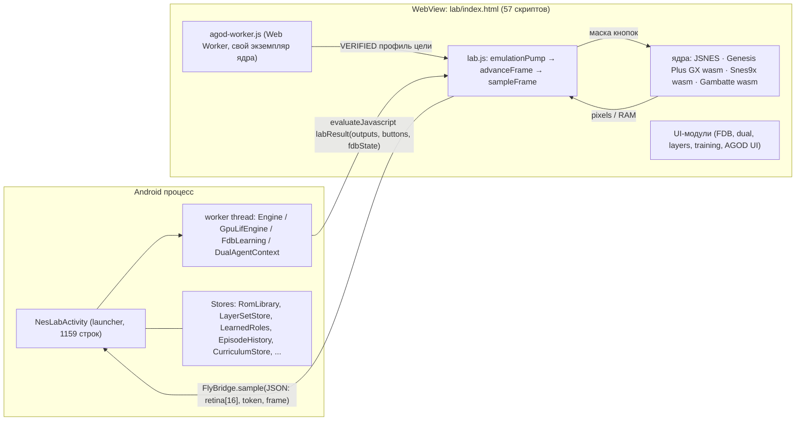
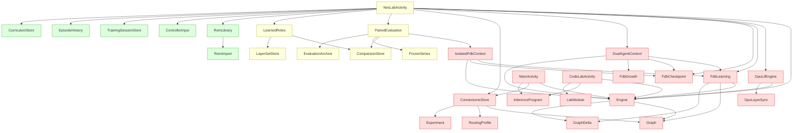
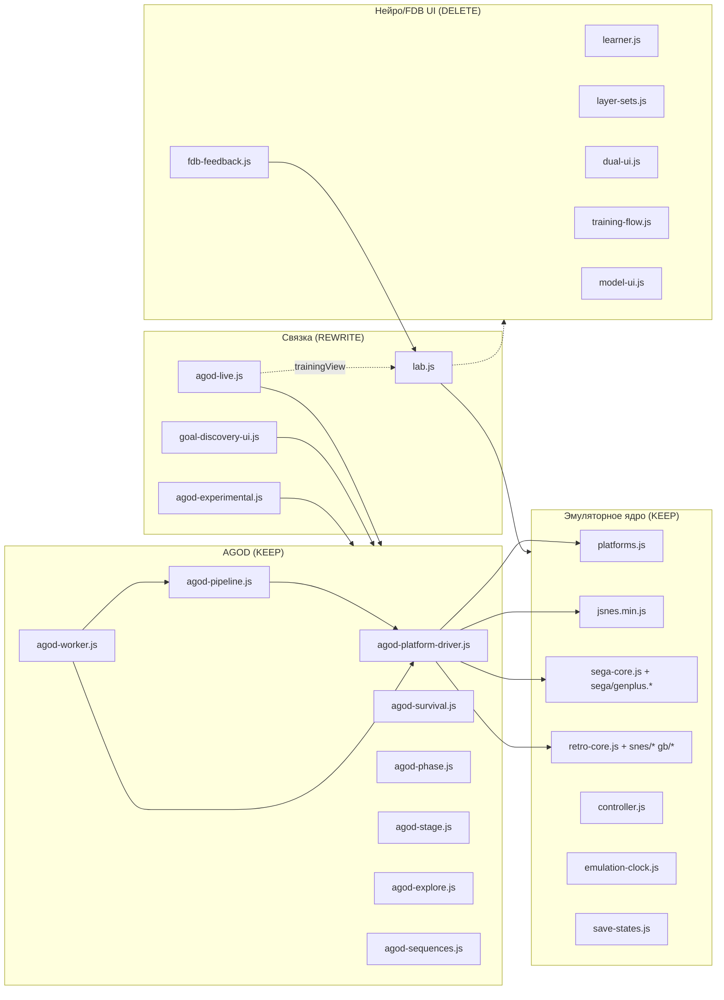

# GU_DEBLOAT_DEPENDENCY_AUDIT

**Фаза:** Architecture Reset / Phase 0 (read-only)
**Репозиторий:** `terminaldetector/Gu`
**Базовый коммит:** `2be2dae` (ветка `research/agod-neural-e0-e1`; `main` = `000c619`, не трогался)
**Режим:** исходники, Issues, коммиты и ветки не менялись. Тесты и сборка выполнялись на экспортированной копии (`git archive 2be2dae`) вне рабочего дерева.

---

## 0. Как получены данные

| Что | Метод | Где проверить |
|---|---|---|
| Граф Java | разбор 46 классов пакета `org.node.flyconsole`: из исходника удалены комментарии, строки и символьные литералы, затем ищутся ссылки на имена классов | §3, таблица J |
| Граф WebView JS | для каждого из 73 скриптов `assets/lab` (72 + `sega/genplus.js`; ещё 2 в `assets/code`) найдены объявленные глобали (`root.FlyX=`, `window.X=`, верхнеуровневые `const/class/function`) и ссылки на них в других файлах; ложные совпадения по общим словам (`status`, `apply`) отфильтрованы вручную | §4 |
| Мост JS↔Java | `@JavascriptInterface` методы `NesLabActivity.Bridge` (36 шт.) и места их вызова в JS | §2.2 |
| Нагрузка на эмулятор/нейро/AGOD | счёт упоминаний предметных терминов по файлам; функции `lab.js` размечены по преобладающей предметной области | §4.2 |
| Тесты | `tools/check.sh` (154 команды), `tools/run_ui_checks.cjs` (24 UI-набора), сборка APK `gradle assembleDebug` | `GU_MIGRATION_TEST_PLAN.md` §1 |

Ограничения: граф статический. Динамические обращения через `window[...]`, `typeof X==='function'` и строки в `evaluateJavascript` из Java пойманы только там, где имя стоит в коде буквально. Поэтому каждое удаление в миграции подтверждается тестом (см. план миграции).

---

## 1. Инвентарь

947 отслеживаемых файлов:

| Группа | Файлов | Комментарий |
|---|---|---|
| `docs/reports/**` | 487 | отчёты прошлых этапов (JSON/логи), в сборку не входят |
| `tools/**` | 239 | проверки CI, исследовательские скрипты, генераторы ROM, сборка ядер |
| `app/src/**` | 147 | 46 Java-классов, 101 ассет (WebView: 75 JS, 1 HTML, 6 CSS, JSON, лицензии) |
| прочее | 74 | `docs/*.md` (28), `research/mesen-causal` (10), `ui-preview` (17 PNG), gradle, workflow |

Не отслеживаются, но обязательны в сборке:
- `assets/lab/snes/*` (Snes9x wasm) и `assets/lab/gb/*` (Gambatte wasm): собираются `tools/build_retro.py`;
- `assets/male-cns.fly.gz`: Male CNS v1.0, 83 МБ; в APK лежит как `assets/male-cns.fly`, 91,6 МБ сжато / 206 МБ.

**Состав debug APK на базовом коммите** (собран локально, 151 089 763 байт, SHA-256 `ca55e34c…74ef`):

| Компонент | Сжато в APK |
|---|---|
| `assets/male-cns.fly` (Male CNS) | **91,6 МБ** |
| `lib/*/libmlkit_google_ocr_pipeline.so` (ML Kit OCR, 4 ABI) | **41,0 МБ** |
| эмуляторы `lab/snes` + `lab/sega` + `lab/gb` (с исходниками для лицензий) | 12,4 МБ |
| `classes*.dex` | 3,6 МБ |
| модели ML Kit OCR в `assets/mlkit-google-ocr-models` | 1,3 МБ |
| весь остальной JS/HTML/CSS | < 1 МБ |

---

## 2. Текущая архитектура исполнения

### 2.1 Контур «кадр → решение → кнопки»

Свойства, важные для замены runtime:
1. **Наблюдение агента — 16 чисел.** `lab.js:sampleFrame()` (стр. 626) передаёт `retina` (4×4 средняя яркость), а не кадр. Пиксели живут в JS-куче WebView (`nes.frame()` → canvas `putImageData`, стр. 357). Наружу из WebView кадр сейчас не выходит.
2. **Транспорт — JSON-строка через `addJavascriptInterface`**, ответ через `evaluateJavascript(window.labResult(...))`. Каждое решение — это два прохода границы JS↔Java с сериализацией. Для 20–30 Гц с кадрами такой канал не годится (см. `GU_MINIMAL_CORE_MANIFEST.md` §4).
3. **Темп** задаёт `emulationPump()` через MessageChannel. Режим `lockstep` останавливает эмуляцию, пока ждёт ответа сети (`waiting()` → `pendingToken!==null`); режим `realtime` пропускает выборки (`interval = 1.25 × lastWindowWall`). Очереди кадров нет: одновременно ждёт ответа не больше одного запроса (`pendingToken`). Этот принцип стоит сохранить.
4. **Изоляция уже есть.** Нейровызовы в `lab.js` обёрнуты `neuralStep()`, а `window.labNeuralSuspended` отключает их. Если Male CNS не загрузился, `NesLabActivity.loadGraph()` (стр. 166) выдаёт `MODEL_UNAVAILABLE`, а ручная игра остаётся доступной. Это подтверждают `neural_isolation_check.cjs` и UI-наборы. Изоляция — точка опоры для безопасной миграции.

### 2.2 Мост `FlyBridge` (36 методов)

| Группа | Методы | Судьба |
|---|---|---|
| Консоль / жизненный цикл | `switchSystem`, `finishSystemSwitch`, `acceptRom`, `pickRom`, `romLibrary`, `controls`, `systemButtons`, `orientation`, `gameDisplay`, `stop`, `resume`, `lifecyclePending`, `lifecycleSaved`, `finishExit`, `console`, `demo`, `diagnostics`, `recognizeScore`, `recording`, `exportCsv`, `trainingSessions`, `episodeHistory`, `curriculum` | **KEEP** (сигнатуры), реализацию вынести из `NesLabActivity` |
| Нейроконтур (Male CNS / FDB) | `configure`, `sample`, `fdbFeedback`, `selectConnectome`, `installSyntheticGraph`, `importModel`, `exportModel`, `layerSets`, `evaluationSeries` | **DELETE**: заменяются `AgentRuntime`-портом (кадр → действие, награда, чекпоинт адаптера) |
| Два агента | `dualConfigure`, `dualSample`, `dualBoundary`, `dualExit` | **DELETE** (вернуть позже поверх нового агента, если понадобится 2P-агент) |

### 2.3 Где запускается AGOD

| Контур | Файлы | Связь с нейроконтуром |
|---|---|---|
| Ядро AGOD (UMD, Node + Worker) | 21 модуль `agod-*.js` + `agod-dqn.js` | **нет**: 0 ссылок на FDB/Male CNS/LIF (проверено поиском). Единственное совпадение — комментарий в `agod-explore.js:92` о «skill memory FDB» |
| Воркер в приложении | `agod-worker.js` + ядра платформ | нет; строит **собственный** экземпляр эмулятора из байтов ROM |
| Связка с игрой | `agod-live.js` | читает глобали `lab.js` (`romHash`, `labPlatform`, `trainingView`); выдаёт награду, которую потребляют `lab.js`/`fdb-feedback.js` |
| Флаг | `agod-experimental.js` (`gu-agod-neural-experimental-v1`) | флаг «AGOD + neural contour» |
| UI | `goal-discovery-ui.js` | глобали `lab.js` |
| Исследовательский стенд (Node) | `tools/agod_realrom_check.cjs` | **смешан**: frontier-архив, recovery teacher, разметчик пригодности, позиционная диагностика и проверка прохождения стадии соседствуют с 27 типами операций `FdbGameBridge` |

---

## 3. Граф зависимостей Java

Ячейка `зависит от` — какие классы пакета упоминает файл; `используется в` — обратные рёбра.

Центральные узлы:
- `Graph`: 20 обратных рёбер.
- `Engine`: 10.
- `GraphDelta`: 10.
- `NesLabActivity`: 38 прямых рёбер, то есть зависит почти от всего пакета.

Без нейроконтура обходятся 13 классов, которые нужны минимальному ядру: `ControllerInput`, `RomImport`, `RomLibrary`, диагностика, хранилища эпизодов и сессий. Ни у одного из них нет ребра к `Graph`, `Engine` или `Fdb*`.

### Таблица J — классификация Java (46 файлов)

| Файл | Строк | Решение | Роль | Зависит от | Используется в | Обоснование |
|---|---|---|---|---|---|---|
| `BestPromotionGate.java` | 48 | **REWRITE** | statistical promotion gate | — | ComparisonStore, NesLabActivity | Generic statistics; keep logic, retarget identity. |
| `CheckpointDigest.java` | 21 | **KEEP** | whole-state digest helper | — | ComparisonStore, CurriculumStore, DiagnosticJournal, EpisodeHistory, EvaluationArchive, FrozenSeries, IsolatedFdbContext, LearnedRoles, NesLabActivity, PairedEvaluation | Small generic hashing helper used by stores. |
| `CodeLabActivity.java` | 31 | **DELETE** | JS code lab activity | ConnectomeStore, Engine, Graph, GraphCache, InferenceProgram, LabDiagnostics, LabModule, MainActivity, NesLabActivity, UiInsets | MainActivity, NesLabActivity | Calls Engine/InferenceProgram; not part of the agent product. |
| `ComparisonStore.java` | 83 | **REWRITE** | preregistered comparisons | BestPromotionGate, CheckpointDigest, EvaluationArchive, LearnedRoles | LearnedRoles, NesLabActivity, PairedEvaluation | Generic protocol; currently keyed to FDB layer identity. |
| `ConnectomeStore.java` | 94 | **DELETE** | connectome loader/selector | Experiment, Graph, GraphCache, RoutingProfile | CodeLabActivity, MainActivity, NesLabActivity | Loads male-cns.fly at app start. |
| `ControllerInput.java` | 58 | **KEEP** | Android gamepad/joystick input | — | NesLabActivity | Emulator input, model-independent. |
| `CurriculumStore.java` | 85 | **KEEP** | trajectory groups (train/test separation) | CheckpointDigest, RomImport | NesLabActivity | Needed by the new trainer to keep train/holdout apart. |
| `DeviceLog.java` | 82 | **KEEP** | app-wide device log | DiagnosticJournal | DiagnosticsApplication, NesLabActivity | Independent of neural worker. |
| `DiagnosticJournal.java` | 72 | **KEEP** | diagnostic journal | CheckpointDigest | DeviceLog, DiagnosticSummary | Generic. |
| `DiagnosticSummary.java` | 16 | **KEEP** | diagnostic summary | DiagnosticJournal | NesLabActivity | Generic. |
| `DiagnosticsApplication.java` | 24 | **KEEP** | Application class | DeviceLog | — | Crash/diagnostic bootstrap. |
| `DualAgentContext.java` | 101 | **DELETE** | two-agent FDB context | Engine, Experiment, FdbCheckpoint, FdbGrowth, FdbLearning, Graph, GraphDelta | DualLayerStore, NesLabActivity | FDB dual mode. |
| `DualLayerStore.java` | 43 | **DELETE** | two-agent layer store | DualAgentContext, LayerSetStore | NesLabActivity | FDB dual mode. |
| `DualRequestGuard.java` | 17 | **DELETE** | dual request ordering | — | NesLabActivity | FDB dual mode (generic idea may be reused). |
| `Engine.java` | 182 | **DELETE** | LIF engine (Male CNS) | Graph, GraphDelta | CodeLabActivity, DualAgentContext, Experiment, FdbGrowth, FdbLearning, GpuLifEngine, InferenceProgram, IsolatedFdbContext, MainActivity, NesLabActivity | Neural backend; no role without Male CNS. Archive in research branch. |
| `EpisodeHistory.java` | 46 | **KEEP** | append-only episode records | CheckpointDigest, RomImport | NesLabActivity | Model-independent episode log. |
| `EvaluationArchive.java` | 25 | **REWRITE** | immutable evaluation proofs | CheckpointDigest | ComparisonStore, NesLabActivity, PairedEvaluation | Generic; identity fields are FDB/graph. |
| `Experiment.java` | 130 | **DELETE** | LIF ports/stimulus | Engine, Graph | ConnectomeStore, DualAgentContext, IsolatedFdbContext, NesLabActivity, RoutingProfile, SyntheticGraphJson | Retina→LIF routing. |
| `FdbCheckpoint.java` | 146 | **DELETE** | FDB checkpoint codec | FdbLearning, Graph, GraphDelta | DualAgentContext, IsolatedFdbContext, NesLabActivity | FDB. |
| `FdbDiagnostics.java` | 19 | **DELETE** | FDB diagnostics | FdbLearning, Graph, GraphDelta | NesLabActivity | FDB. |
| `FdbGrowth.java` | 60 | **DELETE** | FDB structural growth | Engine, Graph, GraphDelta | DualAgentContext, NesLabActivity | FDB. |
| `FdbLayerBinding.java` | 44 | **DELETE** | Current-layer binding to FDB | LayerSetStore, RomImport | NesLabActivity | FDB worker binding. |
| `FdbLearning.java` | 655 | **DELETE** | FDB learner + readouts | Engine, Graph, GraphDelta | DualAgentContext, FdbCheckpoint, FdbDiagnostics, IsolatedFdbContext, NesLabActivity | FDB core. |
| `FrozenSeries.java` | 58 | **REWRITE** | frozen-evaluation proof series | CheckpointDigest | NesLabActivity, PairedEvaluation | Concept required by the new frozen eval; currently LIF-reset semantics. |
| `GpuLayerSync.java` | 101 | **DELETE** | GPU sync of FDB layer | Graph, GraphDelta | GpuLifEngine | FDB/LIF. |
| `GpuLifEngine.java` | 256 | **DELETE** | GPU LIF engine | Engine, GpuLayerSync, Graph, GraphDelta | NesLabActivity | LIF on GPU. |
| `Graph.java` | 37 | **DELETE** | CSR connectome | — | CodeLabActivity, ConnectomeStore, DualAgentContext, Engine, Experiment, FdbCheckpoint, FdbDiagnostics, FdbGrowth, FdbLearning, GpuLayerSync, GpuLifEngine, GraphCache, InferenceProgram, IsolatedFdbContext, LabDiagnostics, MainActivity, NesLabActivity, PairedEvaluation, RoutingProfile, SyntheticGraphJson | Male CNS graph format. |
| `GraphCache.java` | 46 | **DELETE** | connectome cache | Graph | CodeLabActivity, ConnectomeStore, LabDiagnostics, MainActivity, NesLabActivity | Male CNS only. |
| `GraphDelta.java` | 135 | **DELETE** | FDB plastic layer | — | DualAgentContext, Engine, FdbCheckpoint, FdbDiagnostics, FdbGrowth, FdbLearning, GpuLayerSync, GpuLifEngine, IsolatedFdbContext, NesLabActivity | FDB. |
| `InferenceProgram.java` | 42 | **DELETE** | JSON LIF programs | Engine, Graph | CodeLabActivity, MainActivity | MainActivity/CodeLab LIF lab. |
| `IsolatedFdbContext.java` | 55 | **DELETE** | frozen FDB evaluator | CheckpointDigest, Engine, Experiment, FdbCheckpoint, FdbLearning, Graph, GraphDelta, RomImport | NesLabActivity, PairedEvaluation | FDB. |
| `LabDiagnostics.java` | 10 | **DELETE** | graph memory diagnostics | Graph, GraphCache | CodeLabActivity, MainActivity, NesLabActivity | Graph-only. |
| `LabModule.java` | 23 | **DELETE** | code-lab ZIP module | — | CodeLabActivity | CodeLab only. |
| `LabRequestFailure.java` | 23 | **KEEP** | request correlation on failure | — | NesLabActivity | Generic bridge hygiene. |
| `LayerSetStore.java` | 120 | **REWRITE** | app-private checkpoint store | — | DualLayerStore, FdbLayerBinding, LearnedRoles, NesLabActivity | Atomic bounded store is reusable for LFM adapter/head checkpoints; FDB payload semantics must go. |
| `LearnedRoles.java` | 124 | **REWRITE** | Current/Best checkpoint roles | CheckpointDigest, ComparisonStore, LayerSetStore | ComparisonStore, NesLabActivity | Role model (Best needs preregistered paired proof) is reusable for policy checkpoints. |
| `MainActivity.java` | 50 | **DELETE** | LIF inference lab activity | CodeLabActivity, ConnectomeStore, Engine, Graph, GraphCache, InferenceProgram, LabDiagnostics, NesLabActivity, UiInsets | CodeLabActivity | Not launcher; Male CNS stimulation lab. |
| `NesLabActivity.java` | 1159 | **REWRITE** | launcher: WebView host + neural worker + stores (1159 lines) | BestPromotionGate, CheckpointDigest, CodeLabActivity, ComparisonStore, ConnectomeStore, ControllerInput, CurriculumStore, DeviceLog, DiagnosticSummary, DualAgentContext, DualLayerStore, DualRequestGuard, Engine, EpisodeHistory, EvaluationArchive, Experiment, FdbCheckpoint, FdbDiagnostics, FdbGrowth, FdbLayerBinding, FdbLearning, FrozenSeries, GpuLifEngine, Graph, GraphCache, GraphDelta, IsolatedFdbContext, LabDiagnostics, LabRequestFailure, LayerSetStore, LearnedRoles, PairedEvaluation, RomImport, RomLibrary, ScoreOcr, SyntheticGraphJson, TrainingSessionStore, UiInsets | CodeLabActivity, MainActivity | God class: emulator host, ROM library, saves, diagnostics are needed; Engine/FDB/dual/layer code must be removed and replaced by an AgentRuntime interface. |
| `PairedEvaluation.java` | 67 | **REWRITE** | paired frozen evaluation | CheckpointDigest, ComparisonStore, EvaluationArchive, FrozenSeries, Graph, IsolatedFdbContext | NesLabActivity | Depends on IsolatedFdbContext; protocol reusable. |
| `RomImport.java` | 82 | **KEEP** | bounded cartridge import | — | CurriculumStore, EpisodeHistory, FdbLayerBinding, IsolatedFdbContext, NesLabActivity, RomLibrary | Emulator core. |
| `RomLibrary.java` | 64 | **KEEP** | private ROM library | RomImport | NesLabActivity | Emulator core. |
| `RoutingProfile.java` | 61 | **DELETE** | Male CNS routing 16→256→12 | Experiment, Graph | ConnectomeStore | Male CNS sensorimotor profile. |
| `ScoreOcr.java` | 63 | **KEEP*** | bundled ML Kit OCR for score discovery | — | NesLabActivity | Optional module: adds ~41 MB native libs (4 ABIs); decide keep/strip per ABI. |
| `SyntheticGraphJson.java` | 40 | **DELETE** | synthetic graph import | Experiment, Graph | NesLabActivity | Graph-only. |
| `TrainingSessionStore.java` | 142 | **KEEP** | human observation journal | — | NesLabActivity | Demonstration data source for LFM training. |
| `UiInsets.java` | 12 | **KEEP** | window insets helper | — | CodeLabActivity, MainActivity, NesLabActivity | UI shell. |

---

## 4. Граф зависимостей WebView JavaScript

### 4.1 Подграфы

Главный вывод: **ядро AGOD опирается только на `agod-platform-driver.js`, ядра эмуляторов и `platforms.js`.** Таблица ниже показывает, что ни у одного модуля `agod-*` нет ребра к нейро- или FDB-модулям. Рёбра «AGOD → lab.js» из первого прохода ложные: их давало слово `status`. Единственное настоящее ребро — `agod-live.js` → `lab.js` (`trainingView`).

`agod-explore.js` (frontier-архив), `agod-stage.js` (детектор стадии) и `agod-graph.js` не подключены ни в `index.html`, ни в воркере. Их использует только Node-стенд `tools/agod_realrom_check.cjs`. При удалении «неиспользуемых» ассетов эти три файла нужно сохранить (риск R3).

### 4.2 `lab.js`: что в монолите

94 верхнеуровневые функции, 131 КБ. Каждая отнесена к области по преобладающим терминам:

| Область | Объём | Примеры |
|---|---|---|
| только эмулятор | ~23 КБ | `labLoadRom`, `refreshManual`, `keyboardInfo`, `toggleSound`, `validateSnapshot`, `displayPreferences` |
| только нейро/FDB | ~43 КБ | `learnedButtons`, `validateFdb`, `trainingView`, `learningStats`, `fdbOutcomeReward`, `connectBrain`, `requireDurableCurrent`, `labDualTelemetry`, `updateNeuralMap` |
| смешанные | ~58 КБ | `restoreProfile`, `movePad`, `labPause`, `advanceFrame`, `sampleFrame`, `labResult`, `emulationPump`, `updateAgentButtons` |

Смешанные функции содержат цикл эмуляции. Поэтому `lab.js` идёт на **REWRITE**: его надо разделить, а не удалять.

### Таблица JS — зависимости (73 скрипта, рёбра по глобалям)

| Скрипт | Зависит от | Используется в |
|---|---|---|
| `action-hold.js` | — | dual-ui.js, lab.js, shared-experience-ui.js |
| `agent-quick-panel.js` | score-search.js, lab.js(controlsEnabled,profileValues) | — |
| `agod-candidates.js` | agod-consumers.js, agod-ram.js | agod-pipeline.js |
| `agod-causal.js` | — | agod-experimental.js, agod-pipeline.js, agod-worker.js |
| `agod-consumers.js` | agod-ram.js | agod-candidates.js, agod-pipeline.js |
| `agod-dqn.js` | — | agod-experimental.js |
| `agod-evidence.js` | agod-replay.js | agod-experimental.js, agod-live.js, agod-pipeline.js, agod-survival.js, agod-worker.js |
| `agod-experimental.js` | agod-causal.js, agod-dqn.js, agod-evidence.js, agod-goals.js, agod-pipeline.js, agod-platform-driver.js, agod-ram.js, agod-reward.js | goal-discovery-ui.js |
| `agod-explore.js` | — | — |
| `agod-goal-dto.js` | agod-platform-driver.js, agod-replay.js | agod-live.js, agod-worker.js, goal-discovery-ui.js |
| `agod-goals.js` | agod-replay.js | agod-experimental.js, agod-pipeline.js, agod-worker.js |
| `agod-graph.js` | agod-sequences.js | — |
| `agod-live.js` | agod-evidence.js, agod-goal-dto.js, agod-objective.js, agod-pipeline.js, agod-ram.js, agod-replay.js, agod-reward.js, agod-survival.js, lab.js(trainingView) | — |
| `agod-nes-driver.js` | agod-platform-driver.js | goal-discovery-ui.js |
| `agod-objective.js` | agod-pipeline.js, agod-replay.js, agod-survival.js | agod-live.js, goal-discovery-ui.js |
| `agod-phase.js` | agod-sequences.js | agod-survival.js, agod-worker.js |
| `agod-pipeline.js` | agod-candidates.js, agod-causal.js, agod-consumers.js, agod-evidence.js, agod-goals.js, agod-platform-driver.js, agod-ram.js, agod-replay.js, agod-reward.js | agod-experimental.js, agod-live.js, agod-objective.js, agod-worker.js, goal-discovery-ui.js |
| `agod-platform-driver.js` | jsnes.min.js, platforms.js, retro-core.js, sega-core.js | agod-experimental.js, agod-goal-dto.js, agod-nes-driver.js, agod-pipeline.js, agod-ram.js, agod-worker.js, goal-discovery-ui.js |
| `agod-positive.js` | agod-ram.js | — |
| `agod-ram.js` | agod-platform-driver.js | agod-candidates.js, agod-consumers.js, agod-experimental.js, agod-live.js, agod-pipeline.js, agod-positive.js, agod-survival.js, agod-worker.js |
| `agod-replay.js` | — | agod-evidence.js, agod-goal-dto.js, agod-goals.js, agod-live.js, agod-objective.js, agod-pipeline.js, agod-reward.js, agod-survival.js, agod-worker.js, fdb-feedback.js, goal-discovery-ui.js, lab.js, objective-profiles.js |
| `agod-reward.js` | agod-replay.js | agod-experimental.js, agod-live.js, agod-pipeline.js, agod-survival.js, agod-worker.js |
| `agod-sequences.js` | — | agod-graph.js, agod-phase.js |
| `agod-stage.js` | agod-survival.js | — |
| `agod-survival.js` | agod-evidence.js, agod-phase.js, agod-ram.js, agod-replay.js, agod-reward.js | agod-live.js, agod-objective.js, agod-stage.js, agod-worker.js |
| `agod-worker.js` | agod-causal.js, agod-evidence.js, agod-goal-dto.js, agod-goals.js, agod-phase.js, agod-pipeline.js, agod-platform-driver.js, agod-ram.js, agod-replay.js, agod-reward.js, agod-survival.js, jsnes.min.js, platforms.js | — |
| `archive-replay.js` | learner.js, training-sessions.js | archive-ui.js |
| `archive-ui.js` | archive-replay.js, lab.js(agentAllowedMask,learningBoundary,learningKey,learningStats,…) | — |
| `autonomous-episodes.js` | save-states.js, score-search.js, lab.js(profileValues,requireDurableCurrent) | — |
| `benchmark.js` | — | lab.js |
| `console-navigation.js` | platforms.js, lab.js(connectBrain,controlsEnabled,leaveGame,openGame,…) | — |
| `controller.js` | — | lab.js |
| `core-probe.js` | nes-write-trace.js | goal-discovery-ui.js |
| `curriculum-ui.js` | save-states.js, lab.js(learningBoundary,trainingView) | — |
| `dual-ui.js` | action-hold.js, game-tools.js, lab.js(agentAllowedMask,controlsEnabled,nativeCall,openGame,…) | — |
| `emulation-clock.js` | — | lab.js |
| `episode-history-ui.js` | — | — |
| `episode-starts.js` | save-states.js, score-search.js | — |
| `fdb-diagnostics.js` | lab.js(fdbConfiguration,nativeCall) | — |
| `fdb-feedback.js` | agod-replay.js, lab.js(persistPolicy,trainingView) | — |
| `game-tools.js` | — | dual-ui.js, goal-discovery.js, lab.js, layer-ui.js, shared-experience-ui.js, state-ui.js |
| `goal-discovery-ui.js` | agod-experimental.js, agod-goal-dto.js, agod-nes-driver.js, agod-objective.js, agod-pipeline.js, agod-platform-driver.js, agod-replay.js, core-probe.js, goal-discovery.js, objective-profiles.js, platforms.js | — |
| `goal-discovery.js` | game-tools.js | goal-discovery-ui.js, objective-profiles.js |
| `human-capture.js` | — | training-journal.js |
| `interface-settings.js` | — | interface-ui.js |
| `interface-ui.js` | interface-settings.js, lab.js(controlsEnabled,displayPreferences,fitVideo,openGame,…) | — |
| `jsnes.min.js` | sega/genplus.js | agod-platform-driver.js, agod-worker.js, lab.js, nes-write-trace.js, state-ui.js |
| `lab.js` | action-hold.js, agod-replay.js, benchmark.js, controller.js, emulation-clock.js, game-tools.js, jsnes.min.js, layer-sets.js, learner.js, platforms.js, retro-core.js, save-states.js, score-search.js, sega-core.js | agent-quick-panel.js, agod-live.js, archive-ui.js, autonomous-episodes.js, console-navigation.js, curriculum-ui.js, dual-ui.js, fdb-diagnostics.js, fdb-feedback.js, interface-ui.js, layer-ui.js, model-ui.js, objective-profiles.js, score-ui.js, shared-experience-ui.js, shell-ui.js, state-ui.js, training-flow.js, training-journal.js |
| `layer-sets.js` | training-sessions.js | lab.js, layer-ui.js, nes-write-trace.js, objective-profiles.js, training-sessions.js |
| `layer-ui.js` | game-tools.js, layer-sets.js, learner.js, lab.js(fdbConfiguration,keysEqual,nativeCall,policyConfiguration,…) | — |
| `learner.js` | — | archive-replay.js, lab.js, layer-ui.js |
| `model-ui.js` | lab.js(nativeCall,persistPolicy) | — |
| `nes-write-trace.js` | jsnes.min.js, layer-sets.js, save-states.js, shared-experience.js, training-sessions.js | core-probe.js |
| `objective-profiles.js` | agod-replay.js, goal-discovery.js, layer-sets.js, save-states.js, shared-experience.js, training-sessions.js, lab.js(validateProfile) | goal-discovery-ui.js |
| `platforms.js` | — | agod-platform-driver.js, agod-worker.js, console-navigation.js, goal-discovery-ui.js, lab.js, shell-ui.js |
| `retro-core.js` | — | agod-platform-driver.js, lab.js |
| `rom-library-ui.js` | — | — |
| `save-states.js` | — | autonomous-episodes.js, curriculum-ui.js, episode-starts.js, lab.js, nes-write-trace.js, objective-profiles.js, state-ui.js |
| `score-search.js` | — | agent-quick-panel.js, autonomous-episodes.js, episode-starts.js, lab.js, score-ui.js, shared-experience.js |
| `score-ui.js` | score-search.js, lab.js(learningBoundary,openGame,presentVideo,profileValues,…) | — |
| `sega-core.js` | — | agod-platform-driver.js, lab.js |
| `sega/genplus.js` | — | jsnes.min.js |
| `session-logger.js` | — | — |
| `settings.js` | — | state-ui.js |
| `shared-experience-ui.js` | action-hold.js, game-tools.js, shared-experience.js, lab.js(agentAllowedMask,fdbConfiguration,nativeCall,trainingView) | — |
| `shared-experience.js` | score-search.js | nes-write-trace.js, objective-profiles.js, shared-experience-ui.js, training-sessions.js |
| `shell-ui.js` | platforms.js, lab.js(connectBrain,controlsEnabled,leaveGame,openGame,…) | — |
| `state-ui.js` | game-tools.js, jsnes.min.js, save-states.js, settings.js, lab.js(learningBoundary,modelStorageKey,persistPolicy,releasePorts,…) | — |
| `synthetic-import.js` | — | — |
| `techtest-config.js` | — | — |
| `training-flow.js` | lab.js(connectBrain,controlsEnabled,emulationSpeedLabel,fdbConfiguration,…) | — |
| `training-journal.js` | human-capture.js, training-sessions.js, lab.js(agentAllowedMask,learningStats,leaveGame,nativeCall,…) | — |
| `training-sessions.js` | layer-sets.js, shared-experience.js | archive-replay.js, layer-sets.js, nes-write-trace.js, objective-profiles.js, training-journal.js |

---

## 5. Обязательные зависимости от Male CNS, FDB, Graph, старых контроллеров и системы обучения

«Обязательная» значит: без неё сейчас не собирается, не запускается или не проходит CI.

| # | Зависимость | Где (файл:строка / шаг) | Обязательна для | Как снимается |
|---|---|---|---|---|
| D1 | Загрузка Male CNS при старте лаунчера | `NesLabActivity.loadGraph()` :166 → `ConnectomeStore.load` | старт агента; при ошибке ручная игра работает (`MODEL_UNAVAILABLE`) | ветвь `loadGraph` убирается вместе с `ConnectomeStore`; консоль уже умеет работать без модели |
| D2 | Male CNS в APK по умолчанию | `app/build.gradle`: `guTechAssets='male'`, `guTechConnectome='male-cns-v1.0'` проверяются `GradleException` | сборка; 91,6 МБ APK | убрать свойства и проверки; `noCompress 'gz'` больше не нужен |
| D3 | Подготовка графа в CI | `android.yml`: `male_cns_converter_check.py`, `bundle_data.py`, «Check full Male CNS model», `check_full_dual.sh`; зависимости numpy/pandas/pyarrow | CI | шаги удаляются; `requirements.txt` переписывается под тренер и экспорт |
| D4 | Наблюдение агента = 16-значная «сетчатка» | `lab.js:sampleFrame()` :626; `RoutingProfile` (16→256→12) | контур решения | заменяется портом кадров (FrameSource, см. манифест §4) |
| D5 | JSON-мост решения | `FlyBridge.sample/configure/fdbFeedback` ↔ `window.labResult` | контур решения | заменяется AgentRuntime-портом |
| D6 | «Durable Current checkpoint» перед запуском агента | `lab.js:requireDurableCurrent()` :603, `FdbLayerBinding`, `LayerSetStore` | старт агента | гейт сохраняется по смыслу («нет решения без зафиксированного чекпоинта»), но для чекпоинта LFM-адаптера |
| D7 | Награда AGOD → FDB | `agod-live.js` → `lab.js` / `fdb-feedback.js`; `tools/agod_l1_bridge_check.cjs` | связка AGOD с обучением | порт `RewardSink` агента; AGOD публикует VERIFIED/PROVISIONAL/UNKNOWN без изменений |
| D8 | Исследовательский стенд AGOD завязан на `FdbGameBridge` | `tools/agod_realrom_check.cjs`: `bridge()` :64, `learn()` :693, `recoveryTeacher()` :411 вызывает `java.call` (`decide`, `engineSave/Restore`, `boundary`) | teacher, разметка, оценка | **разделить**, см. R1 |
| D9 | Старый линейный контроллер | `learner.js` (SARSA(λ)), импортируется в `controller_check`, `game_tools_check`, `two_player_mode_check`, `system_controls_check`, `console_reset_check`, `runtime_flow_check` | CI-проверки консоли | заменить в тестах фикстурой агента |
| D10 | GPU LIF | `GpuLifEngine`, `GpuLayerSync`, `gpu_runtime_check.py`, `gpu_shader_check.py`; CI ставит EGL/GLES | CI | удаляется |
| D11 | Нейро-UI в разметке | `index.html`: вкладки `network`, `learning`, панели `connectomeModelPanel`, `fdbLearningPanel`, `layerPanel`, `dualPanel`, `sharedExperiencePanel`, `archiveLearningPanel`, `partnerPanel` | UI-наборы | панели удаляются, нужные места занимает панель нового агента |
| D12 | Второй и третий activity | `MainActivity` (LIF-лаборатория), `CodeLabActivity` (JS-лаборатория, вызывает `Engine`) | Manifest | удаляются |
| D13 | ML Kit OCR | `build.gradle: com.google.mlkit:text-recognition:16.0.1`, `ScoreOcr` | распознавание счёта (опция) | не нейроконтур, но 41 МБ; решение владельца (KEEP*) |

**Не обязательны** (ложные зависимости, которые при чистке легко принять за обязательные):
- ядро AGOD (`agod-*`): нейроссылок нет;
- `save-states.js`, `episode-starts.js`, `score-search.js`, `human-capture.js`, `benchmark.js`: модель-независимы;
- `CurriculumStore`, `EpisodeHistory`, `TrainingSessionStore`: на `Graph` и `Fdb*` не ссылаются.

---

## 6. Классификация KEEP / REWRITE / DELETE

Решения:
- **KEEP** — нужно минимальному ядру (эмуляторы, AGOD, ROM, ввод, диагностика, данные), переносится без изменения смысла.
- **REWRITE** — функция нужна, но код связан с Male CNS или FDB либо с `lab.js`; переписывается под новые порты.
- **DELETE** — специфично для Male CNS, LIF, FDB, dual или Layer Set, роли в новой архитектуре нет. Удаляется из продуктового дерева, но **сначала архивируется** веткой `archive/gu-2be2dae-male-cns-fdb` (push тегов запрещён политикой прокси, HTTP 403), история не теряется.

Сводка:

| Область | KEEP | REWRITE | DELETE |
|---|---|---|---|
| Java (46) | 13 (+1 KEEP\*: OCR) | 8 | 24 |
| Ассеты `app/src/main` (103) | 66 | 17 | 20 |
| `tools/**` (239) | 123 | 39 | 77 |

Объём: в Java уходит 2 378 строк из 4 852, ещё 1 684 строки переписываются. В ассетах уходит 157 КБ JS/JSON и 85 МБ графа.

### 6.1 Ассеты WebView и Android

| Файл | КБ | Решение | Роль | Обоснование |
|---|---|---|---|---|
| `AndroidManifest.xml` | 1 | **REWRITE** | manifest (3 activities, INTERNET removed) | Drop MainActivity/CodeLabActivity; keep INTERNET removal (offline). |
| `MALE-CNS-NOTICE.txt` | 1 | **DELETE** | Male CNS notice | Remove together with the graph. |
| `NOTICE.txt` | 2 | **KEEP** | third-party notices | Must be regenerated after removals. |
| `code/index.html` | 5 | **DELETE** | code lab page |  |
| `code/lab.js` | 10 | **DELETE** | code lab |  |
| `code/worker-source.js` | 3 | **DELETE** | code lab worker |  |
| `lab/JSNES-LICENSE.txt` | 10 | **KEEP** | license |  |
| `lab/action-hold.js` | 1 | **REWRITE** | controller delivery policy | Comment binds it to "neural decisions/FDB"; the hold/timeout policy itself is reusable for agent actions. |
| `lab/agent-quick-panel.js` | 12 | **REWRITE** | agent controls panel | Becomes the LFM agent panel. |
| `lab/agod-candidates.js` | 22 | **KEEP** | AGOD core module | UMD, Node+Worker; 0 references to FDB/Male CNS (verified). |
| `lab/agod-causal.js` | 15 | **KEEP** | AGOD core module | UMD, Node+Worker; 0 references to FDB/Male CNS (verified). |
| `lab/agod-consumers.js` | 11 | **KEEP** | AGOD core module | UMD, Node+Worker; 0 references to FDB/Male CNS (verified). |
| `lab/agod-dqn.js` | 10 | **KEEP** | AGOD Double-DQN baseline | Research baseline; no FDB code (comment only). |
| `lab/agod-evidence.js` | 17 | **KEEP** | AGOD core module | UMD, Node+Worker; 0 references to FDB/Male CNS (verified). |
| `lab/agod-experimental.js` | 7 | **REWRITE** | flag "AGOD + neural contour" | Keep worker runner; drop the neural-contour coupling. |
| `lab/agod-explore.js` | 16 | **KEEP** | AGOD core module | UMD, Node+Worker; 0 references to FDB/Male CNS (verified). |
| `lab/agod-goal-dto.js` | 15 | **KEEP** | AGOD core module | UMD, Node+Worker; 0 references to FDB/Male CNS (verified). |
| `lab/agod-goals.js` | 12 | **KEEP** | AGOD core module | UMD, Node+Worker; 0 references to FDB/Male CNS (verified). |
| `lab/agod-graph.js` | 5 | **KEEP** | AGOD core module | UMD, Node+Worker; 0 references to FDB/Male CNS (verified). |
| `lab/agod-live.js` | 7 | **REWRITE** | live objective → reward source for the running game | Reads lab.js globals (romHash, labPlatform, trainingView); must target the new AgentRuntime reward port. |
| `lab/agod-nes-driver.js` | 1 | **KEEP** | AGOD core module | UMD, Node+Worker; 0 references to FDB/Male CNS (verified). |
| `lab/agod-objective.js` | 19 | **KEEP** | AGOD core module | UMD, Node+Worker; 0 references to FDB/Male CNS (verified). |
| `lab/agod-phase.js` | 12 | **KEEP** | AGOD core module | UMD, Node+Worker; 0 references to FDB/Male CNS (verified). |
| `lab/agod-pipeline.js` | 51 | **KEEP** | AGOD core module | UMD, Node+Worker; 0 references to FDB/Male CNS (verified). |
| `lab/agod-platform-driver.js` | 31 | **KEEP** | AGOD core module | UMD, Node+Worker; 0 references to FDB/Male CNS (verified). |
| `lab/agod-positive.js` | 11 | **KEEP** | AGOD core module | UMD, Node+Worker; 0 references to FDB/Male CNS (verified). |
| `lab/agod-ram.js` | 14 | **KEEP** | AGOD core module | UMD, Node+Worker; 0 references to FDB/Male CNS (verified). |
| `lab/agod-replay.js` | 9 | **KEEP** | AGOD core module | UMD, Node+Worker; 0 references to FDB/Male CNS (verified). |
| `lab/agod-reward.js` | 8 | **KEEP** | AGOD core module | UMD, Node+Worker; 0 references to FDB/Male CNS (verified). |
| `lab/agod-sequences.js` | 42 | **KEEP** | AGOD core module | UMD, Node+Worker; 0 references to FDB/Male CNS (verified). |
| `lab/agod-stage.js` | 6 | **KEEP** | AGOD core module | UMD, Node+Worker; 0 references to FDB/Male CNS (verified). |
| `lab/agod-survival.js` | 35 | **KEEP** | AGOD core module | UMD, Node+Worker; 0 references to FDB/Male CNS (verified). |
| `lab/agod-worker.js` | 14 | **KEEP** | AGOD core module | UMD, Node+Worker; 0 references to FDB/Male CNS (verified). |
| `lab/archive-replay.js` | 5 | **DELETE** | offline imitation into FDB |  |
| `lab/archive-ui.js` | 7 | **DELETE** | archive learning UI |  |
| `lab/autonomous-episodes.js` | 10 | **REWRITE** | round-robin episodes over pinned starts | Agent-agnostic idea; bound to FDB evaluationSeries. |
| `lab/benchmark.js` | 1 | **KEEP** | trial summary statistics (Wilson CI) | Pure, model-independent. |
| `lab/console-navigation.js` | 21 | **REWRITE** | console navigation | 12 neural mentions. |
| `lab/console-shell.css` | 17 | **KEEP** | console styles |  |
| `lab/console-ui.css` | 11 | **KEEP** | console styles |  |
| `lab/controller.js` | 1 | **KEEP** | pad mapping |  |
| `lab/core-probe.js` | 15 | **KEEP** | platform probes (observation only) |  |
| `lab/curriculum-ui.js` | 3 | **KEEP** | curriculum assignment UI | 0 neural mentions. |
| `lab/demo-gb.json` | 42 | **KEEP** | built-in GB cartridge |  |
| `lab/demo-gbc.json` | 42 | **KEEP** | built-in GBC cartridge |  |
| `lab/demo-rom.json` | 32 | **KEEP** | built-in NES diagnostic cartridge | Test fixture. |
| `lab/demo-sega.json` | 85 | **KEEP** | built-in MD cartridge |  |
| `lab/demo-snes.json` | 85 | **KEEP** | built-in SNES cartridge |  |
| `lab/dual-ui.css` | 0 | **DELETE** | dual-agent styles | FDB dual UI. |
| `lab/dual-ui.js` | 28 | **DELETE** | two neural agents UI |  |
| `lab/emulation-clock.js` | 1 | **KEEP** | real-time pacing |  |
| `lab/episode-history-ui.js` | 2 | **KEEP** | episode history UI |  |
| `lab/episode-starts.js` | 4 | **KEEP** | immutable game starts | Needed for curricula/holdout starts. |
| `lab/fdb-diagnostics.js` | 3 | **DELETE** | FDB diagnostics |  |
| `lab/fdb-feedback.js` | 9 | **DELETE** | FDB reward feedback |  |
| `lab/game-tools.js` | 3 | **KEEP** | ROM validation/profile primitives |  |
| `lab/goal-discovery-ui.js` | 36 | **REWRITE** | AGOD UI (discovery, profiles) | AGOD UI; 5 neural mentions, relies on lab.js globals. |
| `lab/goal-discovery.js` | 20 | **KEEP** | read-only RAM hypotheses (S-series) |  |
| `lab/human-capture.js` | 1 | **KEEP** | human input capture with provenance | Demonstration data. |
| `lab/index.html` | 79 | **REWRITE** | single WebView page, 57 scripts | Neural panels/tabs (network, learning, dual, layers) must be removed; console/AGOD UI kept. |
| `lab/interface-settings.js` | 4 | **KEEP** | UI settings model |  |
| `lab/interface-ui.css` | 13 | **KEEP** | styles |  |
| `lab/interface-ui.js` | 24 | **REWRITE** | interface panel | 13 neural mentions. |
| `lab/jsnes-source.json` | 0 | **KEEP** | JSNES provenance |  |
| `lab/jsnes.min.js` | 132 | **KEEP** | NES core (JSNES) | Emulator core. |
| `lab/lab.js` | 137 | **REWRITE** | monolith: emulator loop + neural sampling + FDB UI (131 KB) | ~23 KB emulator-only, ~43 KB neural-only, ~58 KB mixed: split into EmulatorHost + AgentBridge. |
| `lab/layer-sets.js` | 5 | **DELETE** | FDB Layer Sets |  |
| `lab/layer-ui.js` | 17 | **DELETE** | Layer Set UI |  |
| `lab/learner.js` | 8 | **DELETE** | seeded linear SARSA(λ) readout (legacy JS learner) | Old controller learner. |
| `lab/material-ui.css` | 5 | **KEEP** | styles |  |
| `lab/model-ui.js` | 6 | **DELETE** | connectome selection |  |
| `lab/nes-write-trace-LICENSE.txt` | 10 | **KEEP** | license |  |
| `lab/nes-write-trace-source.json` | 1 | **KEEP** | provenance |  |
| `lab/nes-write-trace.js` | 89 | **KEEP** | instrumented NES write trace (AGOD research) |  |
| `lab/objective-profiles.js` | 20 | **KEEP** | objective profile store |  |
| `lab/platforms.js` | 0 | **KEEP** | platform table |  |
| `lab/play-ui.css` | 7 | **KEEP** | styles |  |
| `lab/retro-core.js` | 6 | **KEEP** | libretro wrapper (SNES/GB) | Cores built by tools/build_retro.py (untracked lab/snes, lab/gb). |
| `lab/rom-library-ui.js` | 4 | **KEEP** | ROM library UI |  |
| `lab/save-states.js` | 7 | **KEEP** | save slots (IndexedDB) |  |
| `lab/score-search.js` | 3 | **KEEP** | score counter discovery (RAM+screen) | Diagnostic only, not policy input. |
| `lab/score-ui.js` | 8 | **REWRITE** | score UI | 8 neural mentions. |
| `lab/sega-core.js` | 10 | **KEEP** | Genesis Plus GX wrapper |  |
| `lab/sega/LICENSE.txt` | 62 | **KEEP** | license |  |
| `lab/sega/genplus-source.zip` | 4502 | **KEEP** | corresponding source (licence) |  |
| `lab/sega/genplus.js` | 16 | **KEEP** | Genesis Plus GX (Emscripten) |  |
| `lab/sega/genplus.wasm` | 2037 | **KEEP** | Genesis Plus GX wasm |  |
| `lab/sega/source.json` | 0 | **KEEP** | core provenance |  |
| `lab/session-logger.js` | 11 | **REWRITE** | device evidence logger | 15 neural mentions; logging core is reusable. |
| `lab/settings.js` | 1 | **KEEP** | settings model |  |
| `lab/shared-experience-ui.js` | 7 | **DELETE** | shared experience UI |  |
| `lab/shared-experience.js` | 12 | **DELETE** | shared FDB snapshots |  |
| `lab/shell-ui.js` | 3 | **REWRITE** | shell/exit | 3 neural mentions. |
| `lab/state-ui.js` | 16 | **REWRITE** | save/load UI | 19 neural mentions (pauses brain around loads). |
| `lab/synthetic-import.js` | 2 | **DELETE** | synthetic graph import |  |
| `lab/techtest-config.js` | 0 | **REWRITE** | tech-test build config | AGOD autostart flags are useful; connectome sets are not. |
| `lab/training-flow.js` | 17 | **DELETE** | FDB training flow UI | 57 neural mentions; uses lab.js internals. |
| `lab/training-journal.js` | 9 | **REWRITE** | human session journal UI | Bound to FDB live buffers. |
| `lab/training-sessions.js` | 9 | **KEEP** | human session archive model | 4 mentions only; data model reusable. |
| `male-cns-routing-v1.json` | 12 | **DELETE** | Male CNS routing profile |  |
| `res/drawable/ic_launcher.xml` | 0 | **KEEP** | launcher icon |  |
| `lab/snes/*`, `lab/gb/*` (untracked, built) | 7700/1800 | **KEEP** | Snes9x / Gambatte wasm + source | Produced by `tools/build_retro.py`; CI artifact. |
| `male-cns.fly.gz` (untracked, bundled by CI) | 85000 | **DELETE** | Male CNS v1.0 graph (91.6 MB compressed in APK) | Largest APK component. |

### 6.2 `tools/**` (239 файлов)

Колонка `CI` означает, что файл запускается в `.github/workflows/android.yml`, `tools/check.sh`, `check_full_dual.sh` или `run_ui_checks.cjs`.

| Файл | CI | Решение | Роль | Обоснование |
|---|---|---|---|---|
| `BestPromotionGateCheck.java` | CI | **KEEP** | Java check of BestPromotionGate | Store/IO class kept. |
| `CodeLabCheck.java` | CI | **DELETE** | Java check of CodeLab | Follows the class it tests. |
| `ControllerInputCheck.java` | CI | **KEEP** | Java check of ControllerInput | Store/IO class kept. |
| `CurriculumCheck.java` | CI | **KEEP** | Java check of Curriculum | Store/IO class kept. |
| `DiagnosticJournalCheck.java` | CI | **KEEP** | Java check of DiagnosticJournal | Store/IO class kept. |
| `DualAgentCheck.java` | CI | **DELETE** | Java check of DualAgent | Follows the class it tests. |
| `EngineCheck.java` | CI | **DELETE** | Java check of Engine | Follows the class it tests. |
| `EpisodeHistoryCheck.java` | CI | **KEEP** | Java check of EpisodeHistory | Store/IO class kept. |
| `ExpandedPlasticityCheck.java` | CI | **DELETE** | Java check of ExpandedPlasticity | Follows the class it tests. |
| `ExperimentCheck.java` | CI | **DELETE** | Java check of Experiment | Follows the class it tests. |
| `FdbA2SignalVsStructure.java` |  | **DELETE** | Java check of FdbA2SignalVsStructure.java | Follows the class it tests. |
| `FdbA3CleanSignalVsStructure.java` |  | **DELETE** | Java check of FdbA3CleanSignalVsStructure.java | Follows the class it tests. |
| `FdbCheckpointCheck.java` | CI | **DELETE** | Java check of FdbCheckpoint | Follows the class it tests. |
| `FdbDiagnosticsCheck.java` | CI | **DELETE** | Java check of FdbDiagnostics | Follows the class it tests. |
| `FdbDualCreditCheck.java` | CI | **DELETE** | Java check of FdbDualCredit | Follows the class it tests. |
| `FdbFunctionalLearningBenchmark.java` |  | **DELETE** | Java check of FdbFunctionalLearningBenchmark.java | Follows the class it tests. |
| `FdbGameBridge.java` | CI | **DELETE** | headless FDB/Male CNS bridge | Archive with FDB. |
| `FdbGrowthCheck.java` | CI | **DELETE** | Java check of FdbGrowth | Follows the class it tests. |
| `FdbGrowthReachabilityAudit.java` |  | **DELETE** | Java check of FdbGrowthReachabilityAudit.java | Follows the class it tests. |
| `FdbIdentityCheck.java` | CI | **DELETE** | Java check of FdbIdentity | Follows the class it tests. |
| `FdbLayerBindingCheck.java` | CI | **DELETE** | Java check of FdbLayerBinding | Follows the class it tests. |
| `FdbLearningCheck.java` | CI | **DELETE** | Java check of FdbLearning | Follows the class it tests. |
| `FdbPlasticityCheck.java` | CI | **DELETE** | Java check of FdbPlasticity | Follows the class it tests. |
| `FdbProjectionCacheCheck.java` | CI | **DELETE** | Java check of FdbProjectionCache | Follows the class it tests. |
| `FdbProjectionCheck.java` | CI | **DELETE** | Java check of FdbProjection | Follows the class it tests. |
| `FdbTemporalExperiment.java` | CI | **DELETE** | Java check of FdbTemporalExperiment.java | Follows the class it tests. |
| `FdbUnknownRewardCheck.java` | CI | **DELETE** | Java check of FdbUnknownReward | Follows the class it tests. |
| `FixtureBridge.java` |  | **DELETE** | fixture bridge for LIF |  |
| `FrozenFdbCheck.java` | CI | **DELETE** | Java check of FrozenFdb | Follows the class it tests. |
| `FrozenSeriesCheck.java` | CI | **REWRITE** | Java check of FrozenSeries | Follows the class it tests. |
| `GpuLayerSyncCheck.java` | CI | **DELETE** | Java check of GpuLayerSync | Follows the class it tests. |
| `GraphDeltaCheck.java` | CI | **DELETE** | Java check of GraphDelta | Follows the class it tests. |
| `GraphIdentityCheck.java` | CI | **DELETE** | Java check of GraphIdentity | Follows the class it tests. |
| `InferenceCheck.java` | CI | **DELETE** | Java check of Inference | Follows the class it tests. |
| `LabRequestFailureCheck.java` | CI | **KEEP** | Java check of LabRequestFailure | Store/IO class kept. |
| `LayerSetStoreCheck.java` | CI | **REWRITE** | Java check of LayerSetStore | Follows the class it tests. |
| `LearnedRolesCheck.java` | CI | **REWRITE** | Java check of LearnedRoles | Follows the class it tests. |
| `MaleCnsActivityProbe.java` |  | **DELETE** | Java check of MaleCnsActivityProbe.java | Follows the class it tests. |
| `MaleCnsGraphCheck.java` | CI | **DELETE** | Java check of MaleCnsGraph | Follows the class it tests. |
| `MaleCnsRoutingProfile.java` |  | **DELETE** | Java check of MaleCnsRoutingProfile.java | Follows the class it tests. |
| `PairedEvaluationCheck.java` | CI | **REWRITE** | Java check of PairedEvaluation | Follows the class it tests. |
| `ReleaseCheck.java` | CI | **DELETE** | Java check of Release | Checks Engine/Graph/GraphCache release invariants. |
| `RomImportCheck.java` | CI | **KEEP** | Java check of RomImport | Store/IO class kept. |
| `RomLibraryCheck.java` | CI | **KEEP** | Java check of RomLibrary | Store/IO class kept. |
| `RoutingProfileCheck.java` | CI | **DELETE** | Java check of RoutingProfile | Follows the class it tests. |
| `SyntheticGraphCheck.java` | CI | **DELETE** | Java check of SyntheticGraph | Follows the class it tests. |
| `SyntheticLearningCheck.java` | CI | **DELETE** | Java check of SyntheticLearning | Follows the class it tests. |
| `TrainingSessionStoreCheck.java` | CI | **KEEP** | Java check of TrainingSessionStore | Store/IO class kept. |
| `action_hold_check.cjs` | CI | **REWRITE** |  |  |
| `action_hold_ui_check.cjs` |  | **REWRITE** |  |  |
| `agent_quick_panel_ui_check.cjs` |  | **REWRITE** | neural/FDB/agent UI or game check |  |
| `agent_teaching_panel_ui_check.cjs` |  | **REWRITE** | neural/FDB/agent UI or game check |  |
| `agod_app_e2e_check.cjs` |  | **REWRITE** | AGOD in-app end-to-end | Loads lab page; follow the UI rewrite. |
| `agod_baselines_check.cjs` |  | **KEEP** | AGOD test / research script / fixture ROM generator |  |
| `agod_blind_homebrew.cjs` |  | **KEEP** | AGOD test / research script / fixture ROM generator |  |
| `agod_build_manifest.py` |  | **KEEP** | AGOD test / research script / fixture ROM generator |  |
| `agod_candidates_unit.cjs` |  | **KEEP** | AGOD test / research script / fixture ROM generator |  |
| `agod_causal_check.cjs` |  | **KEEP** | AGOD test / research script / fixture ROM generator |  |
| `agod_consumers_check.cjs` |  | **KEEP** | AGOD test / research script / fixture ROM generator |  |
| `agod_consumers_smoke.cjs` |  | **KEEP** | AGOD test / research script / fixture ROM generator |  |
| `agod_d1_frontier_check.cjs` | CI | **KEEP** | AGOD test / research script / fixture ROM generator |  |
| `agod_d2_progress_check.cjs` | CI | **KEEP** | AGOD test / research script / fixture ROM generator |  |
| `agod_dqn_check.cjs` |  | **KEEP** | AGOD test / research script / fixture ROM generator |  |
| `agod_entry_procedure_sweep.cjs` |  | **KEEP** | AGOD test / research script / fixture ROM generator |  |
| `agod_evidence_check.cjs` |  | **KEEP** | AGOD test / research script / fixture ROM generator |  |
| `agod_experimental_bridge_check.cjs` |  | **REWRITE** | AGOD experimental flag | Follows agod-experimental.js. |
| `agod_explore_check.cjs` | CI | **KEEP** | AGOD test / research script / fixture ROM generator |  |
| `agod_g3_platform_independence_test.cjs` | CI | **KEEP** | AGOD test / research script / fixture ROM generator |  |
| `agod_g4_platform_scenarios.cjs` | CI | **KEEP** | AGOD test / research script / fixture ROM generator |  |
| `agod_g5_sequence_check.cjs` | CI | **KEEP** | AGOD test / research script / fixture ROM generator |  |
| `agod_goal_dto_check.cjs` |  | **KEEP** | AGOD test / research script / fixture ROM generator |  |
| `agod_l1_bridge_check.cjs` | CI | **REWRITE** | AGOD VERIFIED reward → FDB bridge gate | Becomes AGOD → AgentRuntime reward-port contract test. |
| `agod_partition_agreement_check.cjs` |  | **KEEP** | AGOD test / research script / fixture ROM generator |  |
| `agod_phase_detector_regression.cjs` |  | **KEEP** | AGOD test / research script / fixture ROM generator |  |
| `agod_phase_evidence.cjs` |  | **KEEP** | AGOD test / research script / fixture ROM generator |  |
| `agod_pipeline_check.cjs` |  | **KEEP** | AGOD test / research script / fixture ROM generator |  |
| `agod_platform_driver_check.cjs` | CI | **KEEP** | AGOD test / research script / fixture ROM generator |  |
| `agod_polarity_audit.cjs` |  | **KEEP** | AGOD test / research script / fixture ROM generator |  |
| `agod_positive_check.cjs` |  | **KEEP** | AGOD test / research script / fixture ROM generator |  |
| `agod_positive_s4b_check.cjs` |  | **KEEP** | AGOD test / research script / fixture ROM generator |  |
| `agod_private_rom_gate.cjs` |  | **KEEP** | AGOD test / research script / fixture ROM generator |  |
| `agod_provenance.cjs` |  | **KEEP** | AGOD test / research script / fixture ROM generator |  |
| `agod_ram_check.cjs` |  | **KEEP** | AGOD test / research script / fixture ROM generator |  |
| `agod_real_game_check.cjs` |  | **KEEP** | AGOD test / research script / fixture ROM generator |  |
| `agod_realrom_check.cjs` | CI | **REWRITE** | AGOD real-ROM research harness: frontier explore, recovery teacher, suitability labeller, position diagnostic, stage verification | Mixed with FDB bridge (27 FdbGameBridge ops). Split: AGOD research harness (keep) vs FDB learn/distill (archive). |
| `agod_replay_check.cjs` |  | **KEEP** | AGOD test / research script / fixture ROM generator |  |
| `agod_reward_check.cjs` |  | **KEEP** | AGOD test / research script / fixture ROM generator |  |
| `agod_rom_check.cjs` | CI | **KEEP** | AGOD controlled-ROM foundation check |  |
| `agod_rom_eligibility_gate.cjs` |  | **KEEP** | AGOD test / research script / fixture ROM generator |  |
| `agod_s10b_trajectory_check.cjs` |  | **KEEP** | AGOD test / research script / fixture ROM generator |  |
| `agod_s11a_transition_check.cjs` |  | **KEEP** | AGOD test / research script / fixture ROM generator |  |
| `agod_s11b_adapter.cjs` |  | **KEEP** | AGOD test / research script / fixture ROM generator |  |
| `agod_s11b_horizon_check.cjs` |  | **KEEP** | AGOD test / research script / fixture ROM generator |  |
| `agod_s11b_host.cjs` |  | **KEEP** | AGOD test / research script / fixture ROM generator |  |
| `agod_s11b_r1_schedule_test.cjs` |  | **KEEP** | AGOD test / research script / fixture ROM generator |  |
| `agod_s11b_r2_phase_channel_test.cjs` |  | **KEEP** | AGOD test / research script / fixture ROM generator |  |
| `agod_s11b_r4_dual_dependence_test.cjs` |  | **KEEP** | AGOD test / research script / fixture ROM generator |  |
| `agod_s11b_r5_transient_test.cjs` |  | **KEEP** | AGOD test / research script / fixture ROM generator |  |
| `agod_s11b_r7_comparison.cjs` |  | **KEEP** | AGOD test / research script / fixture ROM generator |  |
| `agod_s11b_t2_equivalence.cjs` |  | **KEEP** | AGOD test / research script / fixture ROM generator |  |
| `agod_s11c_first_event_check.cjs` |  | **KEEP** | AGOD test / research script / fixture ROM generator |  |
| `agod_s9_control_check.cjs` |  | **KEEP** | AGOD test / research script / fixture ROM generator |  |
| `agod_sacrifice_check.cjs` |  | **KEEP** | AGOD test / research script / fixture ROM generator |  |
| `agod_stage_check.cjs` | CI | **KEEP** | AGOD test / research script / fixture ROM generator |  |
| `agod_survival_check.cjs` | CI | **KEEP** | AGOD test / research script / fixture ROM generator |  |
| `agod_validity_check.cjs` |  | **KEEP** | AGOD test / research script / fixture ROM generator |  |
| `agod_worker_platforms_check.cjs` |  | **KEEP** | AGOD worker on 4 cores in a real browser | Page fixture only; must survive the shell rewrite. |
| `archive_replay_check.cjs` | CI | **DELETE** | archive imitation into FDB |  |
| `autonomous_console_ui_check.cjs` |  | **REWRITE** | neural/FDB/agent UI or game check |  |
| `autonomous_episodes_ui_check.cjs` |  | **REWRITE** | neural/FDB/agent UI or game check |  |
| `benchmark_check.cjs` | CI | **KEEP** |  |  |
| `build_nes_trace.py` | CI | **KEEP** | NES write-trace build |  |
| `build_retro.py` | CI | **KEEP** | pinned Snes9x/Gambatte builds |  |
| `build_sega.py` | CI | **KEEP** | pinned Genesis Plus GX build |  |
| `build_techtest_set.sh` |  | **REWRITE** | tech-test APK sets | Connectome sets go; AGOD flags stay. |
| `bundle_data.py` | CI | **DELETE** | bundles male-cns graph into assets |  |
| `bundle_male_cns.py` |  | **DELETE** |  |  |
| `check.sh` | CI | **REWRITE** | main CI suite (154 commands) | Remove FDB/LIF/dual steps, keep emulator/AGOD/store steps, add new agent gates. |
| `check_full_dual.sh` | CI | **DELETE** | full Male CNS dual checks | Male CNS only. |
| `check_no_private_binaries.sh` |  | **KEEP** | guard: no ROM/private binaries committed | Must stay as a pre-commit/CI guard. |
| `check_no_private_binaries_test.sh` |  | **KEEP** |  |  |
| `code_ui_check.cjs` |  | **DELETE** |  |  |
| `code_worker_check.cjs` | CI | **DELETE** |  |  |
| `console_layout_check.cjs` |  | **REWRITE** |  |  |
| `console_navigation_ui_check.cjs` |  | **REWRITE** |  |  |
| `console_reset_check.cjs` | CI | **REWRITE** |  |  |
| `continuation_ui_check.cjs` |  | **REWRITE** | neural/FDB/agent UI or game check |  |
| `controller-fixture/android/content/Context.java` | CI | **KEEP** | emulator build glue / test fixtures (libretro bridge, Sega API6, Android input stubs, vendored) |  |
| `controller-fixture/android/hardware/input/InputManager.java` | CI | **KEEP** | emulator build glue / test fixtures (libretro bridge, Sega API6, Android input stubs, vendored) |  |
| `controller-fixture/android/view/InputDevice.java` |  | **KEEP** | emulator build glue / test fixtures (libretro bridge, Sega API6, Android input stubs, vendored) |  |
| `controller-fixture/android/view/InputEvent.java` |  | **KEEP** | emulator build glue / test fixtures (libretro bridge, Sega API6, Android input stubs, vendored) |  |
| `controller-fixture/android/view/KeyEvent.java` |  | **KEEP** | emulator build glue / test fixtures (libretro bridge, Sega API6, Android input stubs, vendored) |  |
| `controller-fixture/android/view/MotionEvent.java` |  | **KEEP** | emulator build glue / test fixtures (libretro bridge, Sega API6, Android input stubs, vendored) |  |
| `controller_check.cjs` | CI | **REWRITE** | pad check | Uses learner.js (FlyLearner). |
| `convert.py` | CI | **DELETE** | graph converter |  |
| `convert_male_cns.py` |  | **DELETE** | Male CNS converter |  |
| `convert_shiu.py` |  | **DELETE** | FlyWire converter |  |
| `core_probe_check.cjs` | CI | **KEEP** |  |  |
| `current_gate_check.cjs` | CI | **DELETE** | FDB durable Current gate |  |
| `current_layer_check.cjs` | CI | **DELETE** | neural/FDB/agent UI or game check |  |
| `demonstration_check.cjs` | CI | **DELETE** | learner.js demonstration |  |
| `dual_game_check.cjs` | CI | **DELETE** | neural/FDB/agent UI or game check |  |
| `dual_layout_check.cjs` |  | **DELETE** | neural/FDB/agent UI or game check |  |
| `dual_routing_check.cjs` | CI | **DELETE** | neural/FDB/agent UI or game check |  |
| `dual_ui_check.cjs` | CI | **DELETE** | neural/FDB/agent UI or game check |  |
| `emulation_clock_check.cjs` | CI | **KEEP** |  |  |
| `emulator_baseline.cjs` |  | **KEEP** | emulator throughput baseline |  |
| `episode_starts_ui_check.cjs` |  | **KEEP** |  |  |
| `expanded_game_check.cjs` | CI | **DELETE** | neural/FDB/agent UI or game check |  |
| `fdb_carry_check.cjs` | CI | **DELETE** | neural/FDB/agent UI or game check |  |
| `fdb_diagnostics_check.cjs` | CI | **DELETE** | neural/FDB/agent UI or game check |  |
| `fdb_feedback_check.cjs` | CI | **DELETE** | neural/FDB/agent UI or game check |  |
| `fdb_game_check.cjs` | CI | **DELETE** | neural/FDB/agent UI or game check |  |
| `fdb_readout_check.cjs` | CI | **DELETE** | neural/FDB/agent UI or game check |  |
| `fdb_reward_check.cjs` | CI | **DELETE** | neural/FDB/agent UI or game check |  |
| `game_tools_check.cjs` | CI | **REWRITE** | game-tools check | Imports learner.js. |
| `gmode_check.cjs` | CI | **REWRITE** | human+agent co-play modes |  |
| `goal_discovery_check.cjs` | CI | **KEEP** |  |  |
| `goal_discovery_ui_check.cjs` |  | **REWRITE** | AGOD UI suite | Follows goal-discovery-ui.js. |
| `gpu_runtime_check.py` | CI | **DELETE** | GPU LIF runtime check |  |
| `gpu_shader_check.py` | CI | **DELETE** | GPU LIF shader check |  |
| `human_capture_check.cjs` | CI | **KEEP** |  |  |
| `inspect_diagnostics.py` |  | **REWRITE** | device diagnostics inspector | Neural fields go. |
| `inspect_diagnostics_check.py` | CI | **KEEP** |  |  |
| `interface_settings_check.cjs` | CI | **KEEP** |  |  |
| `interface_ui_check.cjs` |  | **KEEP** |  |  |
| `lab_ui_check.cjs` |  | **DELETE** | neural/FDB/agent UI or game check |  |
| `landscape_ui_check.cjs` |  | **REWRITE** |  |  |
| `layer_sets_check.cjs` | CI | **DELETE** | neural/FDB/agent UI or game check |  |
| `layer_ui_check.cjs` |  | **DELETE** | neural/FDB/agent UI or game check |  |
| `learning_check.cjs` | CI | **DELETE** | learner.js check |  |
| `make_agod_chain_rom.py` |  | **KEEP** | AGOD test / research script / fixture ROM generator |  |
| `make_agod_dual_dependence_rom.py` |  | **KEEP** | AGOD test / research script / fixture ROM generator |  |
| `make_agod_gb_rom.py` |  | **KEEP** | AGOD test / research script / fixture ROM generator |  |
| `make_agod_rate_trap_rom.py` |  | **KEEP** | AGOD test / research script / fixture ROM generator |  |
| `make_agod_sacrifice_rom.py` |  | **KEEP** | AGOD test / research script / fixture ROM generator |  |
| `make_agod_sega_rom.py` |  | **KEEP** | AGOD test / research script / fixture ROM generator |  |
| `make_agod_sequence_rom.py` |  | **KEEP** | AGOD test / research script / fixture ROM generator |  |
| `make_agod_snes_rom.py` |  | **KEEP** | AGOD test / research script / fixture ROM generator |  |
| `make_agod_test_rom.py` |  | **KEEP** | AGOD test / research script / fixture ROM generator |  |
| `make_agod_transition_rom.py` |  | **KEEP** | AGOD test / research script / fixture ROM generator |  |
| `make_nes_trace_rom.py` |  | **KEEP** |  |  |
| `make_retro_roms.py` | CI | **KEEP** | original test ROMs |  |
| `make_sega_rom.py` |  | **KEEP** |  |  |
| `make_test_rom.py` |  | **KEEP** |  |  |
| `male_cns_converter_check.py` | CI | **DELETE** |  |  |
| `male_cns_routing.py` |  | **DELETE** |  |  |
| `male_cns_routing_profile.py` |  | **DELETE** |  |  |
| `male_cns_sources.json` |  | **DELETE** |  |  |
| `model_ui_check.cjs` | CI | **DELETE** | neural/FDB/agent UI or game check |  |
| `nes_check.cjs` | CI | **KEEP** |  |  |
| `nes_write_trace_check.cjs` | CI | **KEEP** |  |  |
| `neural_isolation_check.cjs` | CI | **REWRITE** | emulator survives neural failures | Becomes "agent failure isolation" — a key invariant to preserve. |
| `objective_profiles_check.cjs` | CI | **KEEP** |  |  |
| `objective_profiles_ui_check.cjs` |  | **KEEP** |  |  |
| `plasticity_speed_ui_check.cjs` |  | **DELETE** | neural/FDB/agent UI or game check |  |
| `platform_ui_check.cjs` |  | **KEEP** | 4 platforms, save/load, pads, aspect ratio | Locally red with emcc 3.1.6 cores; green in CI. |
| `polish_ui_check.cjs` |  | **REWRITE** |  |  |
| `portrait_rotation_ui_check.cjs` |  | **KEEP** |  |  |
| `realrom_observation.cjs` |  | **REWRITE** | 16-value retina encoders for the brain | Keep grid()/dims() helpers for frame access; drop legacy-16/motion-16/fused-16 as policy inputs. |
| `realrom_observation_check.cjs` | CI | **REWRITE** | encoder check | Follows realrom_observation.cjs. |
| `release_regression_ui_check.cjs` |  | **REWRITE** |  |  |
| `requirements.txt` | CI | **REWRITE** | python deps (numpy/pandas/pyarrow for the converter) | Needed only by graph tools; becomes the trainer/exporter deps. |
| `retro/bridge.cpp` |  | **KEEP** | emulator build glue / test fixtures (libretro bridge, Sega API6, Android input stubs, vendored) |  |
| `retro_check.cjs` | CI | **KEEP** |  |  |
| `retro_memory_check.cjs` |  | **KEEP** |  |  |
| `run_ui_checks.cjs` | CI | **REWRITE** | UI suite runner (24 suites) | Suite list changes with the UI rewrite. |
| `runtime_flow_check.cjs` | CI | **REWRITE** |  |  |
| `save_states_check.cjs` | CI | **KEEP** |  |  |
| `save_states_ui_check.cjs` | CI | **KEEP** |  |  |
| `score_search_check.cjs` | CI | **KEEP** |  |  |
| `sega-api6/CMakeLists.txt` |  | **KEEP** | emulator build glue / test fixtures (libretro bridge, Sega API6, Android input stubs, vendored) |  |
| `sega-api6/src/main/c/wasm/config.c` |  | **KEEP** | emulator build glue / test fixtures (libretro bridge, Sega API6, Android input stubs, vendored) |  |
| `sega-api6/src/main/c/wasm/config.h` |  | **KEEP** | emulator build glue / test fixtures (libretro bridge, Sega API6, Android input stubs, vendored) |  |
| `sega-api6/src/main/c/wasm/fileio.c` |  | **KEEP** | emulator build glue / test fixtures (libretro bridge, Sega API6, Android input stubs, vendored) |  |
| `sega-api6/src/main/c/wasm/osd.h` |  | **KEEP** | emulator build glue / test fixtures (libretro bridge, Sega API6, Android input stubs, vendored) |  |
| `sega-api6/src/main/c/wasm/wasm.c` |  | **KEEP** | emulator build glue / test fixtures (libretro bridge, Sega API6, Android input stubs, vendored) |  |
| `sega_check.cjs` | CI | **KEEP** | Genesis core checks |  |
| `sega_learning_check.cjs` | CI | **DELETE** |  |  |
| `sega_p2_check.cjs` | CI | **KEEP** | Genesis core checks |  |
| `sega_render_check.cjs` | CI | **KEEP** | Genesis core checks |  |
| `sega_rom_check.cjs` | CI | **KEEP** | Genesis core checks |  |
| `sega_six_button_check.cjs` | CI | **KEEP** | Genesis core checks |  |
| `sega_ui_check.cjs` |  | **DELETE** | neural/FDB/agent UI or game check |  |
| `session_logger_ui_check.cjs` |  | **REWRITE** |  |  |
| `settings_check.cjs` | CI | **KEEP** |  |  |
| `shared_experience_check.cjs` | CI | **DELETE** | neural/FDB/agent UI or game check |  |
| `shared_experience_ui_check.cjs` | CI | **DELETE** | neural/FDB/agent UI or game check |  |
| `synthetic_import_check.cjs` | CI | **DELETE** |  |  |
| `synthetic_to_json.py` |  | **DELETE** | synthetic graph tool |  |
| `system_controls_check.cjs` | CI | **REWRITE** |  |  |
| `test_convert.py` | CI | **DELETE** | converter test |  |
| `training_flow_ui_check.cjs` |  | **REWRITE** | neural/FDB/agent UI or game check |  |
| `training_sessions_check.cjs` | CI | **KEEP** |  |  |
| `training_ui_check.cjs` |  | **REWRITE** | neural/FDB/agent UI or game check |  |
| `two_player_mode_check.cjs` | CI | **REWRITE** | 2P routing | Imports learner.js; 2P input itself is kept. |
| `vendor/jsnes/LICENSE` |  | **KEEP** | emulator build glue / test fixtures (libretro bridge, Sega API6, Android input stubs, vendored) |  |
| `vendor/jsnes/README.md` |  | **KEEP** | emulator build glue / test fixtures (libretro bridge, Sega API6, Android input stubs, vendored) |  |
| `vendor/jsnes/cpu.js` |  | **KEEP** | emulator build glue / test fixtures (libretro bridge, Sega API6, Android input stubs, vendored) |  |

### 6.3 Прочее

| Путь | Решение | Обоснование |
|---|---|---|
| `docs/reports/**` (487) | KEEP (архив) | доказательная история этапов; в сборку не входит |
| `docs/*FDB*`, `docs/MALE-CNS-DATA.md`, `docs/DUAL-MODEL-ARCHITECTURE.md`, `docs/EXPANDED-FDB-PLASTICITY.md`, `V2-GMODE-FDB-GPU.md` | KEEP (архив) → перенести в `docs/archive/` | описывают удаляемую архитектуру |
| `docs/AGOD_*`, `docs/GU_AUTOMATIC_GAME_OBJECTIVE_DISCOVERY_TZ_v1_2.md` | KEEP | спецификация AGOD остаётся в силе |
| `research/mesen-causal/**` | KEEP | независимая инструментальная проверка AGOD (Stage B) |
| `examples/synthetic/*.json` | DELETE (вместе с синтетическими графами) | входы `SyntheticGraphCheck`/`SyntheticLearningCheck` |
| `expanded-comparison.json`, `fdb-comparison.json` (корень) | DELETE | артефакты FDB-проверок, CI перезаписывает их |
| `ui-preview/*.png` | REWRITE | скриншоты регенерируются UI-наборами |
| `README.md`, `RELEASE-*.md`, `THIRD_PARTY.md` | REWRITE | описывают Male CNS/FDB; `THIRD_PARTY.md` обновить после удалений и добавления модели (лицензия LFM Open License v1.0) |
| `.github/workflows/android.yml` | REWRITE | шаги D3/D10 удаляются, добавляются шаги нового агента (см. план тестов) |
| `.github/workflows/signing-tool.yml`, `docs/release-signing.md` | KEEP | подписание релиза не менять без разрешения |

---

## 7. Риски удаления

| # | Риск | Вероятность / цена | Как не допустить |
|---|---|---|---|
| R1 | **Потерять исследовательские механизмы AGOD вместе с FDB.** Frontier-архив (`agod-explore.js` + `exploreRoute`), recovery teacher, разметчик пригодности, позиционная диагностика и проверка прохождения (`verifyLevelClear`, stage detector) живут в `agod_realrom_check.cjs` рядом с 27 операциями `FdbGameBridge` | высокая / очень высокая | стенд **разделяется, а не удаляется**: `agod-research/` (driver, explore, teacher с подключаемой политикой, labeller, stage) плюс адаптер политики. P0-политика Male CNS становится одним из адаптеров в архиве. Директива прямо запрещает удалять эти механизмы из-за связи с FDB |
| R2 | Сломать консоль при выпиливании `lab.js`: цикл эмуляции, ввод, сохранения и звук перемешаны с нейрокодом в 58 КБ «смешанных» функций | высокая / высокая | сначала выделить `EmulatorHost`, нейро-ветви оставить за `neuralStep()`; удалять только после зелёных UI-наборов консоли (план тестов, шаг M2) |
| R3 | Удалить `agod-explore.js`, `agod-stage.js`, `agod-graph.js` как «не подключённые» в `index.html` | средняя / высокая | они нужны Node-стенду; в манифест ядра внесены явно |
| R4 | Потерять изоляцию отказов агента: сейчас её гарантируют `neuralStep`, `labNeuralSuspended` и `neural_isolation_check.cjs` | средняя / высокая | проверку переписать как «agent failure isolation» **до** удаления нейрокода; держать её зелёной на каждом шаге |
| R5 | Потерять хранилища данных обучения: `TrainingSessionStore`, `CurriculumStore`, `EpisodeHistory`, `episode-starts.js`, `human-capture.js` | средняя / высокая | KEEP; это источник демонстраций и разбиения train/holdout для LFM |
| R6 | Неявные вызовы JS → Java по строкам (`nativeCall('…')`) и Java → JS (`evaluateJavascript("window.lab…")`): статический граф их ловит не полностью | средняя / средняя | на каждом шаге проверять, что ни один `nativeCall`, `FlyBridge.*` и `window.lab*` не ссылается на удалённый метод (grep-гейт в плане тестов) |
| R7 | Сломать воспроизводимость ядер: локально собранные emcc 3.1.6 ядра GB/SNES дают красный `platform_ui` (сохранённое состояние GB не восстанавливается), в CI с emsdk 3.1.57 тот же тест зелёный | уже проявился / средняя | эталон — артефакт CI `FlyConsole-retro-cores`; `source.json` фиксирует версию компилятора; базовую линию снимать только на ядрах CI |
| R8 | Удалить вместе с FDB-оценкой понятия frozen-evaluation и preregistration (`FrozenSeries`, `PairedEvaluation`, `ComparisonStore`, `BestPromotionGate`, `LearnedRoles`) | средняя / высокая (методология) | REWRITE: протоколы сохраняются, меняется идентичность чекпоинта (адаптер LFM вместо FDB-слоя) |
| R9 | Потерять гарантии приватности: ROM, RAM-адреса, кадры и трассы в репозиторий не попадают | низкая / очень высокая | `check_no_private_binaries.sh` остаётся KEEP и становится pre-commit-гейтом; модель и датасеты не коммитятся |
| R10 | Регресс offline-гарантии: Manifest сейчас явно удаляет `INTERNET` (`tools:node="remove"`) | низкая / очень высокая | правило сохраняется; модель кладётся в APK или ставится локально, без сетевой загрузки при запуске |
| R11 | Размер APK сдвинется не туда: −91,6 МБ Male CNS, но +220–480 МБ весов LFM (GGUF Q4_0 + mmproj Q8_0 = 322 МБ) | высокая / средняя | Android App Bundle / asset pack или однократный локальный импорт модели (без сети) — решение владельца |

---

## 8. Порядок безопасной миграции

Принцип: каждый шаг обратим и проверяется тестами; ничего не удаляется, пока не зелёная замена. Детальные гейты по шагам — в `GU_MIGRATION_TEST_PLAN.md`.

| Шаг | Содержание | Удаляет? | Гейт выхода |
|---|---|---|---|
| **M0** | Архив: ветка `archive/gu-2be2dae-male-cns-fdb` = `2be2dae` (выполнено; тег создан только локально — push тегов даёт 403). Зафиксировать базовую линию (этот аудит, CI 43703791646) | нет | тег запушен, базовые результаты записаны |
| **M1** | Минимальный AGOD API (интерфейсы + контрактные тесты) поверх существующих модулей; разделить `agod_realrom_check.cjs` на `agod-research` и адаптер FDB-политики | нет | все AGOD-гейты CI зелёные; teacher, labeller и stage-check проходят с «пустой» политикой и с адаптером P0 |
| **M2** | Выделить `EmulatorHost` из `lab.js`: кадр, ввод, сохранения, темп; нейроконтур спрятать за интерфейсом `AgentPort` с текущей реализацией FDB | нет | консольные UI-наборы и `platform_ui` (на CI-ядрах) зелёные; agent-failure-isolation зелёный |
| **M3** | Порт кадров: передача кадра из WebView в нативный код без JSON и без очереди («последний кадр побеждает»); замер задержки | нет | тест задержки «событие → действие», тест «нет устаревших кадров» |
| **M4** | Отключить сборку Male CNS (D2/D3), удалить `MainActivity`, `CodeLabActivity`, LIF/FDB/dual Java и JS, нейропанели UI, соответствующие тесты | **да** | CI зелёный без графа; APK без `male-cns.fly`; grep-гейт R6 пуст |
| **M5** | Подключить новый AgentRuntime (LFM), выбранный в Phase 1 | — | frozen-eval гейты (без savestate, оракула и учителя); бюджет RAM 2–3 ГБ; задержка |
