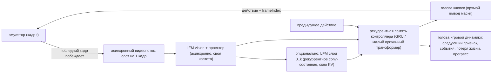

# LFM_STREAMING_WEIGHT_MODIFICATION_OPTIONS

**Фаза:** Architecture Reset / Phase 1 (исследование, без изменений в репозитории)
**Модель:** `LiquidAI/LFM2.5-VL-450M`, ревизия `fc6221ca597f3315e4f82fc2df606783267b34ba` (HF, 2026-04-08)
**Цель:** Streaming Vision-Action Agent — кадры прямо из эмулятора, 20–30 решений/с, offline Android, пик RAM контура 2–3 ГБ.

---

## 0. Источники и уровень проверки

Каждое утверждение помечено уровнем проверки:
- **[исп]** — проверено исполнением на реальных весах в этой сессии;
- **[код]** — проверено чтением исходников модели или runtime (указан файл);
- **[вендор]** — заявление производителя или третьей стороны, не воспроизводилось;
- **[не проверено]** — требует проверки до использования.

| Источник | Версия / ревизия |
|---|---|
| Веса, `config.json`, `processor_config.json`, заголовок safetensors | HF `LiquidAI/LFM2.5-VL-450M@fc6221c`, `model.safetensors` 897 484 568 байт |
| Официальный ONNX | `LiquidAI/LFM2.5-VL-450M-ONNX@95c283d` |
| Официальный GGUF + манифесты LEAP | `LiquidAI/LFM2.5-VL-450M-GGUF@1abed04` |
| LiteRT-LM (сообщество) | `litert-community/LFM2.5-VL-450M@cecb4a6` |
| Код модели | `transformers` 5.23.0: `models/lfm2_vl`, `models/lfm2`, `models/siglip2` |
| llama.cpp | `ggml-org/llama.cpp@de32b26` (только чтение; сборку и запуск отклонил классификатор прав, см. §7) |
| Исполнение | torch 2.15.0 (CPU, fp32), transformers 5.23.0, peft 0.21.3, onnxruntime 1.32.0; x86 Intel Xeon 2,3 ГГц, **4 vCPU**. Это **не Android**: цифры относительные |
| Производитель | блог Liquid AI «LFM2.5-VL-450M», документация docs.liquid.ai, README модели |

---

## 1. Модель: проверенные факты

### 1.1 Архитектура и тензоры [исп: заголовок safetensors, 349 тензоров, BF16]

| Блок | Конфигурация | Параметры |
|---|---|---|
| Vision: SigLIP2 NaFlex (`model.vision_tower.vision_model`) | 12 слоёв, hidden 768, 12 голов, MLP 3072 (`gelu_pytorch_tanh`), патч 16×16; `patch_embedding` — **Linear 768→768**; `position_embedding` [256, 768] = сетка 16×16, интерполируется под NaFlex; `post_layernorm`; head нет | **85 843 200** |
| Проектор (`model.multi_modal_projector`) | pixel-unshuffle 2×2 (768·4 = 3072) → `linear_1` [2048×3072] + GELU → `linear_2` [1024×2048], bias; LayerNorm **выключен** (`projector_use_layernorm: false`) | **8 391 680** |
| LM: LFM2.5-350M (`model.language_model.layers.{0..15}`) | hidden 1024. **conv-слои** 0,1,3,4,6,7,9,11,13,15: `conv.in_proj` [3072×1024] → B, C, x; depthwise `conv.conv` [1024,1,3]; `conv.out_proj` [1024×1024]; вычисление `y = C ⊙ conv(B ⊙ x)`. **attention-слои** 2,5,8,10,12,14: `q_proj` [1024×1024], `k_proj`/`v_proj` [512×1024] (GQA 16/8, head 64), `q_layernorm`/`k_layernorm` [64], `out_proj`, RoPE θ=1e6. FFN SwiGLU `w1`/`w3` [4608×1024], `w2` [1024×4608]: заявлено 6656, `block_auto_adjust_ff_dim` → 4608 | conv-слой 18 355 200, attn-слой 17 303 680; итого **287 374 080** |
| Эмбеддинги | `embed_tokens` [65536×1024]; финальный RMSNorm называется `embedding_norm` | **67 108 864** (+1 024 norm) |
| LM-голова | **связана** с `embed_tokens` [исп: общий `data_ptr`; `_tied_weights_keys` в `modeling_lfm2_vl.py:306`] | 0 своих |
| **Итого** | | **448 718 848** (совпадает с HF API) |

### 1.2 Токены на кадр консоли [исп: настоящий `Lfm2VlProcessor`]

| Кадр | `min_image_tokens=64` (по умолчанию) | `min_image_tokens=32` (рекомендация README) |
|---|---|---|
| NES 256×240 | 64 токена (патчи 16×16) | 64 |
| SNES 256×224 | 72 (16×18; изображение растягивается до минимума) | **56** (14×16) |
| Mega Drive 320×224 | 70 (14×20) | 70 |
| Game Boy 160×144 | 72 (16×18) | **36** (12×12) |

Плюс ≈12 текстовых токенов шаблона (`<|im_start|>user … assistant`).

Важно для устройства: процессор **дополняет `pixel_values` до 1024 патчей** (`max_num_patches`) [исп: форма `[1,1024,768]`]. Encoder тогда работает примерно в 4 раза больше нужного. В ONNX-энкодер нужно подавать ровно N патчей [исп: так сделаны замеры §2].

### 1.3 Скрытые состояния без генерации текста [исп]

- `model.model(…)` — это `Lfm2VlModel`, без LM-головы. Он возвращает `last_hidden_state` [1, T, 1024] и при `output_hidden_states=True` все **17** уровней (эмбеддинги + 16 слоёв). Логиты и генерация не нужны.
- `get_image_features(...)` возвращает признаки кадра после проектора [N_tok, 1024]. Повторный проход LM с `mm_encoder_outputs={'image': feats}` даёт **бит в бит** тот же `last_hidden_state`, что и совместный проход (max |Δ| = 0.0). Значит, vision и LM можно разнести по разным потокам и разной частоте.
- Официальный **ONNX-декодер возвращает только `logits`** и кэши [исп: выходы графа]. Скрытых состояний среди его выходов нет, а LM-голова [65536×1024] считается для **каждого** токена кадра. Для агента нужен пере-экспорт с выходом `hidden` (или правка графа: выход перед `MatMul` LM-головы) [не проверено].
- llama.cpp: `llama_context_params.embeddings=true` + `llama_get_embeddings_ith()` возвращают эмбеддинг токена после финальной нормы [код: `include/llama.h:418, 1147`]. Промежуточные слои напрямую не отдаются [не проверено, возможно через eval-callback].

### 1.4 Потоковое состояние [исп + код]

| Состояние | Размер | Поведение |
|---|---|---|
| conv-состояние (10 слоёв × [1024×3]) | **120 КиБ** fp32, постоянно | рекуррентное; в ONNX явно передаётся как `past_conv.i` [B,1024,3] [исп] |
| KV-кэш (6 слоёв × K,V × 8 голов × 64) | **24 КиБ/токен** fp32 (12 КиБ fp16) | растёт линейно: 72 ток/кадр × 30 к/с ≈ 52 МБ/с fp32 |
| Тип кэша в transformers | `DynamicCache` | длина растёт (168 после двух кадров) [исп] |

Окно контекста: README заявляет 32 768 токенов [вендор], в `config` указано `max_position_embeddings` 128 000. При 30 к/с × 72 токена окно заполняется за 15 с. **Потоковому агенту обязательна политика вытеснения KV** (скользящее окно кадров). Совместимость вытеснения с RoPE-позициями и качеством модели **[не проверено]**.

---

## 2. Стоимость: что измерено

### 2.1 Инференс на CPU x86, 4 vCPU [исп]

| Компонент | Условие | Время |
|---|---|---|
| ONNX vision+проектор fp16 | NES 256 патчей → 64 ток. / SNES 288 → 72 / MD 280 → 70 / GB 288 → 72 | 134 / 136 / 141 / 155 мс |
| ONNX vision q8 / q4 | те же кадры | 118–144 / 128–151 мс: квантование на CPU почти не ускоряет |
| ONNX vision fp16 | SNES при `min32` (224 патча → 56 ток.) | 106–124 мс |
| ONNX декодер q4 | prefill 8 / 40 / 72 / 80 токенов | 29 / 76 / 125 / 141 мс (включая логиты для всех токенов) |
| ONNX декодер q4 | очередной кадр 72 ток. после 0…504 кэшированных | 127–145 мс; рост контекста почти не влияет |
| ONNX декодер q4 | один кэшированный токен | 16,5 мс |
| torch fp32: LM первые k слоёв (84 ток.) | k = 2 / 4 / 8 / 16 | 24 / 40 / 82 / 150 мс |
| **Полный VLM на кадр (ONNX)** | vision + декодер | **≈250–300 мс → 3–4 решения/с** |

### 2.2 Память [исп]

| Конфигурация ONNX Runtime | Пиковый RSS после 20 кадров (1 680 токенов) |
|---|---|
| vision fp16 + embed fp16 + декодер q4 | 1 181 МиБ |
| vision q8 + embed fp16 + декодер q4 | 940 МиБ |

KV-кэш на этих 1 680 токенах занимает 39,4 МиБ (fp32). Бюджет 2–3 ГБ выполним, если KV ограничен окном.

### 2.3 Заявления производителя [вендор]

Блог Liquid AI, Q4_0, «reasons over an image»; длина ответа не указана:

| Разрешение | Jetson Orin | Samsung S25 Ultra (Snapdragon 8 Elite) | AMD Ryzen AI Max+ 395 |
|---|---|---|---|
| 256×256 | 233 мс | **950 мс** | 637 мс |
| 512×512 | 242 мс | **2,4 с** | 944 мс |

### 2.4 Аналитика FLOP на кадр (из форм тензоров)

- vision, 256 патчей: 12 × (7,08 M MAC/патч) × 256 + внимание 1,2 G ≈ **22,9 GMAC**;
- проектор, 64 токена: 0,54 GMAC;
- LM, 76 токенов: 287 M × 76 ≈ 21,8 GMAC, плюс логиты 5,1 GMAC, если их считать.

Итого ≈ 45–50 GMAC (90–100 GFLOP) на кадр. При 30 Гц это ≈ 3 TFLOP/с устойчиво.

**Вывод.** Стоковый «полный VLM на каждый кадр» отстаёт от цели 20–30 решений/с:
- на 4 x86-ядрах в 6–10 раз (измерено);
- на флагманском телефоне по данным производителя примерно в 20–30 раз.

Все три варианта ниже поэтому разводят **быстрый путь решения** и **тяжёлый путь восприятия** по частоте или глубине.

---

## 3. Вариант A — замороженная основа + обучаемая временная политика

**Идея.** LFM2.5-VL не меняется. Его признаки кадра подаются в небольшую обучаемую рекуррентную политику с головами действий.

| Аспект | Решение |
|---|---|
| Модифицируемые тензоры | **ни одного из 349.** Новые модули: (1) пулинг токенов кадра: 4–8 обучаемых запросов × 1024 и cross-attention к N_tok токенам; (2) временное ядро: GRU 1024→512 или 2-слойный причинный трансформер на K последних кадров + эмбеддинг предыдущего действия; (3) головы: действие (факторизованные кнопки или составной набор маск), value, вспомогательные предсказания последствий (событие AGOD: потеря жизни / VERIFIED-прогресс через H шагов, предсказание признака следующего кадра). Объём 1–6 M параметров |
| Источник признаков | (a) **после проектора** (`get_image_features`, [N_tok,1024]) — дешевле всего, LM не нужен [исп]; (b) уровень k LM (k ≤ 4) над токенами кадра — +24–40 мс на x86 [исп]. В обоих случаях генерации нет |
| Обучение на последовательностях | данные: (кадр, действие, последствие) из `TrainingSessionStore` (демонстрации человека), траекторий AGOD-teacher (P/C/D) и собственных прогонов агента. Признаки кадров **кэшируются один раз**, обучение идёт только по головам. Последствия — пакеты `liveReward` (VERIFIED/PROVISIONAL; UNKNOWN не превращается в 0) и разметка `lifeLost` на горизонте H. Разбиение train/holdout — через `CurriculumStore` |
| Стоимость инференса | основа ≈ 106–155 мс/кадр (x86, vision fp16/q8) + голова < 1 мс. Для 20–30 Гц: основа идёт асинхронно на своей частоте (последний кадр побеждает), политика — на 30 Гц по последнему признаку; задержка восприятия ≤ одного периода основы |
| Стоимость обновления | только головы: при кэшированных признаках миллисекунды на батч на CPU телефона [не проверено на устройстве]. Шаг с прямым проходом основы на 4 кадрах: 2,6 с (torch fp32 x86, с дополнением до 1024 патчей) [исп] |
| Экспорт / квантование | официальный `vision_encoder_{fp16,q8,q4}.onnx` уже есть [исп]; для варианта (b) нужен собственный экспорт LM до слоя k. Голова — маленький ONNX или Java/NEON (как readout в FDB) |
| Ограничения | замороженные признаки обобщённой VLM могут не видеть мелкие игровые объекты (пули, снаряды). Разрешение ограничено патчем 16 px и pixel-unshuffle (токен = 32×32 px). Это **главный риск**, его надо измерить, а не предполагать (прошлый M4 показал: 16-ячеечная «сетчатка» не несёт нужной информации) |
| Обязательные проверки | набор V1–V5 из §9 (наблюдаемость, динамика, последствия действий, пригодность для управления, автономная frozen-политика) против константной политики, простых визуальных контроллеров и AGOD baseline; задержка кадр → фактическое действие на устройстве; протокол frozen-оценки |

---

## 4. Вариант B — селективная LoRA (vision / проектор / LM) + головы действий

**Идея.** Как A, но представление дообучается под игру низкоранговыми адаптерами.

| Аспект | Решение |
|---|---|
| Модифицируемые тензоры (точные имена проверены через peft на реальной модели) [исп] | vision: `model.vision_tower.vision_model.encoder.layers.{0..11}.self_attn.{q_proj,v_proj}` (768×768). Проектор: `model.multi_modal_projector.linear_{1,2}`. LM-внимание: `model.language_model.layers.{2,5,8,10,12,14}.self_attn.{q_proj,k_proj,v_proj,out_proj}`. LM-conv: `model.language_model.layers.{0,1,3,4,6,7,9,11,13,15}.conv.{in_proj,out_proj}`. LM-FFN (опционально): `…feed_forward.{w1,w2,w3}` |
| Число обучаемых параметров [исп] | r=8 / r=16: vision q,v **294 912 / 589 824**; проектор **65 536 / 131 072**; LM-внимание **344 064 / 688 128**; LM-conv **491 520 / 983 040**; LM-FFN 2 162 688 / 4 325 376. Набор «vision q,v + LM attn + LM conv», r=8: **1 130 496** (+ голова) |
| Источник признаков | как в A; адаптеры меняют сами признаки |
| Обучение | backprop через vision и LM. Gradient checkpointing поддерживается в LFM2-VL, LFM2 и SigLIP2 (`supports_gradient_checkpointing=True`) [код]. Шаг 4 кадра, LoRA r=8 (vision q,v + attn + conv) + голова: **6,2 с** forward+backward (torch fp32 x86) [исп] |
| Где обучать | **на устройстве проверенного runtime нет.** ONNX Runtime Training для Android заброшен: последняя версия `onnxruntime-training-android` 1.19.2 от 2024-09-03, а инференс-пакет дошёл до 1.32.0 (2026-11-13) [исп: Maven]. llama.cpp `llama-finetune`: «technically functional (for FP32 models…) but the code is very much WIP» [код: `examples/training/README.md`]. ExecuTorch экспортирует только текстовые LFM2/LFM2.5 (`examples/models/lfm2`); VL-варианта нет, обучение на устройстве [не проверено]. Реалистично — локальное обучение на рабочей станции (offline, без облака) и перенос адаптеров на устройство |
| Инференс | адаптеры **сливаются** в веса до квантования, накладных расходов нет; либо подключаются во время работы: llama.cpp `llama_adapter_lora_init` / `llama_set_adapters_lora` [код: `llama.h:697, 735`] — для LM-части; для vision-проектора mtmd [не проверено] |
| Экспорт | слитые веса → GGUF (`convert_hf_to_gguf.py` поддерживает LFM2 и проектор `lfm2` в mtmd [код]) → `llama-quantize`; или пере-экспорт ONNX собственным скриптом: рецепт Liquid для ONNX не опубликован [не проверено] |
| Ограничения | забывание общих навыков модели; ошибка квантования после слияния (нужен замер); обучение на телефоне сейчас неосуществимо на проверенных runtime |
| Обязательные проверки | прирост зонда / успеха против A на тех же данных; качество после Q4/Q8 со слитыми адаптерами; время шага на целевом обучающем устройстве |

---

## 5. Вариант C — модифицированная потоковая архитектура (early-exit, условные вычисления, дистилляция)

**Идея.** Перестроить вычисление под поток. Восприятие дешевле и реже, решение быстро и с ранним выходом. Знания берутся дистилляцией из полной модели (A/B как учитель).

| Компонент | Что меняется | Основание |
|---|---|---|
| Усечённая LM | использовать слои 0…k (k = 4 или 8) как временной интегратор; слои k+1…15 не загружаются (−17–18 M параметров на слой) | время LM 24/40/82/150 мс при k = 2/4/8/16 [исп]; LFM2 рекуррентен в conv-слоях, состояние 120 КиБ |
| Ранние выходы | головы действия и value после слоёв 2, 4, 8 обучаются дистилляцией от полной глубины; на этапе решения выход по уверенности | новые тензоры; веса основы можно заморозить или дообучить LoRA (как B) |
| Условные вычисления по кадрам | (1) пропуск vision, если кадр почти не изменился (разность ниже порога — переиспользуются прошлые токены); (2) двухчастотный режим: vision 8–10 Гц, политика 30 Гц; (3) сжатие токенов после проектора 72 → 16–32 обучаемым пулингом | разделение vision/LM корректно, бит в бит [исп]; качество при сжатии [не проверено] |
| Меньшая сетка патчей | подавать в NaFlex меньше патчей (например 8×8, 16 токенов) с интерполяцией позиций | NaFlex принимает произвольную сетку (`spatial_shapes`) [код]; это ниже `min_image_tokens` процессора, вне распределения обучения — [не проверено] качество, требует дистилляции |
| Окно KV | скользящее окно последних W кадров в 6 attention-слоях; conv-состояние не трогается | без окна KV растёт ~52 МБ/с; RoPE-позиции при вытеснении [не проверено] |
| Дистилляция | учитель — полный LFM2.5-VL (+LoRA из B) offline на записанных траекториях; ученик — усечённый, со сжатыми токенами; потери: KL по действиям, MSE по скрытым состояниям уровня k, вспомогательные задачи последствий | требует корпуса траекторий (AGOD teacher + демонстрации) |
| Модифицируемые тензоры | удаление `layers.{k+1..15}.*`; LoRA как в B; новые: пулинг, головы ранних выходов | — |
| Экспорт | собственный ONNX-экспорт усечённой модели (torch.onnx/dynamo) или GGUF с меньшим числом слоёв (`layer_types` задаётся по слоям) [не проверено] | — |
| Ограничения | самый большой объём работы и исследовательский риск: можно потерять способность видеть мелкие объекты на сниженном разрешении | — |
| Обязательные проверки | кривая «качество зонда / успех — задержка» по k и N_tok; бюджет ≤ 33–50 мс на решение на целевом SoC | — |

---

## 6. Сравнение

| | A: замороженная основа | B: LoRA | C: потоковая модификация |
|---|---|---|---|
| Меняет веса основы | нет | адаптеры (1,1 M при r=8) | адаптеры + удаление слоёв + новые модули |
| Обучаемые параметры | 1–6 M (головы) | +0,3–4,3 M | +пулинг, ранние выходы |
| Обучение на устройстве | **да**, если признаки кэшируются (только головы) | **нет** проверенного runtime | только головы; основа — offline |
| Путь к 20–30 Гц | асинхронная основа + быстрая политика (задержка восприятия ≤ периода основы) | как A | прямой: меньше токенов, меньше слоёв, пропуск кадров |
| Готовый экспорт | vision ONNX готов [исп] | слияние → GGUF (поддержка LFM2-VL есть) [код] | собственный экспорт [не проверено] |
| Главный риск | признаки не видят мелкие объекты | забывание, качество после квантования | исследовательский объём, качество при сжатии |

**Рекомендация.** Идти по ступеням, с гейтами по измерениям, а не выбирать один вариант заранее.
1. **A как первый рабочий контур.** Признаки после проектора, асинхронная основа, политика на 30 Гц. Сначала набор проверок V1–V5 из §9. Предсказание существующих suitability labels само по себе доказательством качества признаков **не считается** (исправление директивы M0).
2. **B offline**, если V1–V4 для A слабы. Сравнить V1–V5 для A и B на одних и тех же отложенных траекториях.
3. **C** — путь к 30 Гц на телефоне. Начинать только после того, как A или B покажут информативные признаки.

---

## 7. Что не проверено и чем это закрыть

| Пункт | Почему не проверено | Как проверить |
|---|---|---|
| Задержка на Android (CPU / GPU / NPU) для каждого компонента | нет устройства; в сессии только x86 | замер на целевом SoC: p50/p95 vision, LM-слои, голова; кадр → действие |
| Сборка и запуск llama.cpp с LFM2.5-VL GGUF | сборку отклонил классификатор прав сессии | собрать в окружении владельца; `llama-mtmd-cli` + `llama-bench` на Q4_0 / mmproj Q8_0 |
| Поддержка `MatMulNBits` / `MultiHeadAttention` (com.microsoft) в NNAPI/QNN EP ONNX Runtime Android | не исполнялось на Android | ORT Android + профилировщик: доля CPU fallback |
| Скрытые состояния промежуточных слоёв в llama.cpp | API отдаёт только финальный эмбеддинг | eval-callback или собственный граф |
| Качество при N_tok < 64 и при сетке меньше штатной | вне распределения обучения | зонд + успех на отложенных траекториях |
| Вытеснение KV при RoPE | не исполнялось | тест: окно W кадров, сравнение с полным контекстом |
| LiteRT-LM (сообщество) | известные дефекты runtime: видна только верхняя четверть изображения (LiteRT-LM #3246, сборка `fixB`), перенос short-conv состояния между разговорами | считать неготовым до исправления в upstream |
| Обучение на устройстве для B | нет поддерживаемого runtime | решение владельца: обучение на локальной рабочей станции или отказ от B на устройстве |

---

## 8. Лицензия и размер

- **Лицензия:** LFM Open License v1.0, на основе Apache 2.0, с ограничением коммерческого использования: права действуют, пока годовая выручка ниже **10 млн долларов США** (`LICENSE`, разд. 5). Изменённые файлы нужно помечать, копию лицензии и NOTICE прикладывать. `THIRD_PARTY.md` нужно обновить.
- **Размер официальных артефактов** [исп: API HF]:

| Формат | Файлы | Размер |
|---|---|---|
| GGUF | Q4_0 + mmproj Q8_0 | 219 + 103 МБ |
| GGUF | Q8_0 | 379 МБ |
| ONNX | vision q8 + embed fp16 + decoder q4 | 110 + 134 + 481 МБ |
| LiteRT-LM | int4 | 407 МБ |

Поставка без сети при запуске, способ (в APK, asset pack или локальный импорт) решает владелец.

---

## 9. Критерии качества визуальных признаков (исправление директивы M0)

Предсказание существующих suitability labels **не является** достаточным доказательством качества визуальных признаков. M4-02c показал, что эти метки зависят от скрытой фазы игры и продолжения маршрута, а не от видимого состояния. Признаки проверяются пятью отдельными тестами. Все тесты идут на **отложенных** траекториях: разбиение train/holdout по происхождению состояния через `CurriculumStore`. Сравнение всегда ведётся с тремя опорами: **константной политикой**, **простыми визуальными контроллерами** (пиксельные признаки 4×4 / 16×12 / 64×48 и компенсированное движение, тот же обучаемый контроллер) и **AGOD baseline** (open-loop replay маршрута, frontier/teacher, Double-DQN `agod-dqn.js`).

| # | Проверка | Что измеряется | Ссылка «истины» (только для оценки, не на вход политики) |
|---|---|---|---|
| V1 | Визуальная наблюдаемость | декодируются ли из признаков видимые сущности: позиция игрока, число и положение врагов и снарядов, ресурс (жизни), фаза/сцена; линейный и малый нелинейный зонд, R² / точность | причинные RAM-поля, доказанные AGOD (`agod-phase` causal probe, `agod-survival`); RAM-адреса не публикуются |
| V2 | Пространственная и временная динамика | предсказание признаков и видимых сущностей на +1…+k кадров; скорость и направление объектов; различение статичной сцены и скролла | те же поля на следующих кадрах; компенсированное движение (`realrom_observation` grid) как baseline |
| V3 | Предсказание последствий действий | при фиксированном кадре предсказать исход для **каждого** действия: изменение позиции, потерю жизни на горизонте H, прогресс, событие AGOD (VERIFIED/PROVISIONAL; UNKNOWN не превращается в 0) | разметка с ветвлением из точного состояния (исследовательский эмулятор, savestate разрешён **только** здесь): `hold`-режим и закрытые продолжения, а не продолжение маршрута |
| V4 | Пригодность для управления | компактный контроллер на признаках, обученный offline на демонстрациях и траекториях teacher, при оценке **закрытым контуром** на коротких сегментах: выживание, прогресс, восстановление после вмешательства | исход сегмента на эмуляторе |
| V5 | Полностью автономная frozen-политика | целые эпизоды: без savestate, оракула, учителя и AGOD-контроллера, без обновления весов; delays 0/1/2/4/8 и вмешательства, отличные от обучающих; несколько seed; прогресс, потери жизней, восстановление, `LEVEL_CLEAR` (оракул только после прогона) | stage detector + оракул post-run |

Правило продолжения: V5 — итоговый критерий. V1–V4 — диагностические гейты, они объясняют провал V5, но заменить его не могут. Модель, которая не превосходит простые визуальные контроллеры на V1–V4, дальше не интегрируется.

## 10. Целевая архитектура: Streaming Vision-Action Agent (директива M0)

Приоритет — прямой выход управляющей головы из визуальных признаков и промежуточных состояний LFM2.5-VL-450M. **Полная языковая генерация не находится в цикле оперативного управления.**

| Требование директивы | Реализация в проекте |
|---|---|
| Асинхронный видеопоток | порт `FrameSource` (манифест §4): слот на 1 кадр, без очереди устаревших кадров; vision работает на своей частоте |
| Рекуррентная память | GRU / причинный трансформер контроллера + conv-состояние LFM (120 КиБ) и KV-окно слоёв 0..k |
| Прямой вывод кнопок | голова над памятью; факторизованные кнопки или составные маски, без токенов текста |
| Предсказание игровой динамики | вспомогательная голова (V2/V3-цели), обучается на тех же последовательностях |
| Обучение компактного контроллера | только контроллер и головы; признаки LFM кэшируются (вариант A) |
| Последующая LoRA-адаптация LFM | вариант B, offline; адаптеры сливаются до квантования |
| Задержка кадр → фактическое действие | `action_binding_check` / `frame_port_latency_check`: метки `frameIndex` кадра наблюдения и кадра применения действия, p50/p95 на устройстве |
| Бюджет RAM 2–3 ГБ | замер `agent_memory_budget_check`; ONNX-контур на x86 — 0,94–1,18 ГБ (§2.2) |

Порядок (директива M0, п. 5): сначала минимальный APK с эмуляторами и AGOD, подтверждённый тестами. Только после этого — интеграция визуальной модели, **отдельным** изменением, не вместе с очисткой.

