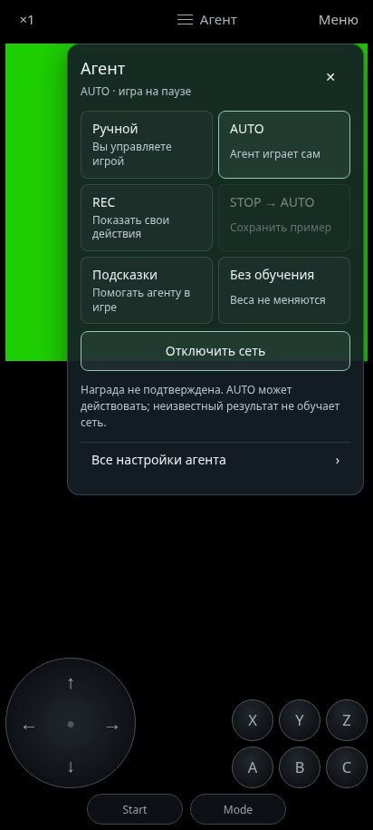
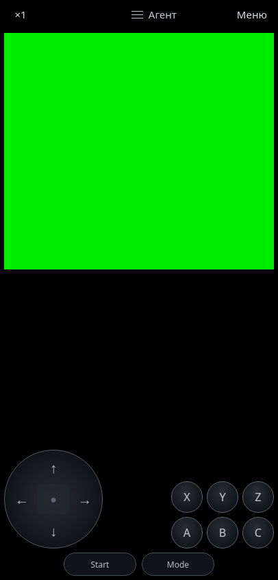

# GU 2.1.4 · REC, подсказки, сеть и портретный режим

21 октября 2026. Ветка `feature/autonomous-learning-emulator`.

В небольшую панель **≡ Агент** возвращены **REC**, **STOP → AUTO**,
**Подсказки** и отдельное **Отключить / Подключить сеть**. Основной игровой
экран сохраняет три кнопки строки; широкая лабораторная панель не возвращается.
Режимы расположены в две колонки. В короткой альбомной ориентации прокручивается
только окно, все действия остаются доступны с касаниями и клавиатурой.

## Запись и переключение

REC работает на ×1. При открытии панели, обычного меню или аппаратного Back
игровые часы останавливаются сразу. Затем завершается архив записи, ожидается
текущий neural ACK, отправляются только ещё не переданные выполненные примеры,
подтверждается FDB-граница и записывается checkpoint. Только после этого
обычная пауза меняет generation и очищает очередь. Частичный последний пример
сохраняется; весь архив повторно не проигрывается.

Ожидание Current ACK и записи истории обязательно уступает очередь событий
таймером. Это устраняет цикл без ожидания, который мог не дать завершиться
самому подтверждению. Таймаут и ошибка остаются явными, а не превращаются
в успешное сохранение. Общий механизм используют также прежний STOP и
переключатели пластичности. Время стадий пластичности по-прежнему измеряется
отдельно.

Back при сохранении в панели завершает закрытие после подтверждения. Обычное
меню не выполняет повторный переход и не исполняет игровые кадры во время
сохранения; «Продолжить» возвращает тот же REC. Смена игры, внешняя пауза или
уход в фон отменяют запоздалое продолжение. Сброс процесса и все разновидности
Android lifecycle не объявляются аппаратно проверенными этим изменением.

**STOP → AUTO** продолжает с показанного кадра, с приобретёнными изменениями.
**Подсказки** записывают выполненный человеческий ввод отдельно от действий
агента. Само нажатие не становится положительной наградой. Неизвестный исход
не передаётся FDB как выдуманная нулевая/положительная награда.

Отдельное отключение сети сохраняет выбранный формат REC/подсказок/AUTO,
оставляя ручную игру. Пока сеть отключена, обычные нажатия не записываются как
подсказки. Подключение возвращает выбранный формат, без загрузки прежнего
Save State или отката весов. «Ручной» остаётся самостоятельным выбором обычной
игры без обучения.

## Ориентация и ввод

Правило скрытия кнопок для `landscape-gamepad` ограничено альбомной ориентацией.
Оставшийся до следующего layout-кадра CSS-класс больше не скрывает управление
в портрете. Регрессия воспроизводится с намеренно задержанным обработчиком
поворота, включая событие смены графа.

В режиме **Авто** нейтральное перечисление input-устройства не убирает кнопки.
Автоматическая раскладка геймпада включается после реального ввода не виртуального
устройства. Фактически использованный геймпад выбирается вместо нейтрального
служебного устройства; отключение возвращает сенсорный ввод. Явные настройки
«Геймпад», «Экранные кнопки» и пользовательские позиции сохраняются.

Виртуальные устройства сохраняют рабочий ввод и назначение кнопок. Фильтрации
по имени нет. Native-пакеты и журнал подключений дополнены `sources` и
`virtual`, которых не хватало в полученной записи. Наличие служебного устройства
в старом журнале не доказывает его точные флаги или причину всех симптомов
на телефоне.

## Проверки и пределы

Точные результаты браузерных наборов записаны в `browser-checks.json` и `.log`,
общая проверка и Android build/lint — в отдельных журналах и `validation.json`.
Новые проверки включены в Android APK workflow:

- `agent_teaching_panel_ui_check.cjs`: настоящие NES/MD и архивы, задержанный
  Current ACK, незавершённый inference и последний пример, точная однократная
  передача, REC/STOP/подсказки, обычное меню/Back и независимое отключение сети.
- `portrait_rotation_ui_check.cjs`: настоящие NES/MD, повороты с задержанным
  layout, смена метаданных графа, нейтральный/виртуальный/физический ввод,
  подключение/отключение, сохранённые предпочтения и границы видео/кнопок.

Neural и Android input-ответы в браузерных проверках — явные protocol fixtures.
Они проверяют интеграцию интерфейса и сохранений, а не доказывают обучение
полного коннектома на пользовательской игре. Скриншоты сделаны с нашими ROM.
Физическая приёмка новой версии на Android остаётся необходимой.

[Новый журнал устройства](device-log-review.md) подтверждает около 60 FPS Sega,
успешные автосохранения и работу Male CNS на CPU. Нейронная реакция около
214 мс и 3,53 ответа/с остаётся измеренной задержкой; ускорение вычислений
в этой UI-правке не заявляется. Строгого сравнения графов и проверки активной
игры при уходе в фон в записи нет. Сырые журналы в репозиторий не включены.

## Результат локального прогона

Все **21 браузерный набор**, `tools/check.sh` и сборки
`assembleDebug lintDebug assembleRelease lintRelease` прошли. Lint: 0 ошибок,
19 прежних предупреждений на вариант. Подпись debug APK и точное совпадение
49 верхних JS/HTML/CSS-ресурсов APK с исходниками проверены.
`apk.json` описывает локальный APK; CI пересобирает ту же версию отдельно.
Полные сравнительные JSON общей проверки дополнительно публикуются CI как
`FlyConsole-plasticity-results`; локальные SHA256 приведены в
`comparison-artifacts.json` без копирования прежних больших отчётов в UI-дифф.

## Проверка публикации APK

В [Actions #130](https://github.com/terminaldetector/Gu/actions/runs/39654717756)
общая проверка прошла, но шаг интерфейсных тестов завершился с ошибкой; сборка
APK была пропущена. Этот запуск не считается успешной публикацией 2.1.4.
Доступная страница показала только код завершения шага, без имени теста.

Для следующего прогона `tools/run_ui_checks.cjs` сохраняет отдельные stdout/stderr,
коды завершения, время и версии Node/Playwright/браузера. Артефакт
`FlyConsole-ui-check-results` публикуется и при ошибке; аннотация Actions
указывает конкретный тест и причину. Наборы, порядок и проверки сохранены,
повторные попытки и подавление ошибок не добавлены. Дополнительные локальные
прогоны REC с замедлением CPU в 4/12 раз и панели/поворота в 4 раза прошли;
они не устанавливают причину отказа #130 и не заменяют успешный CI.

