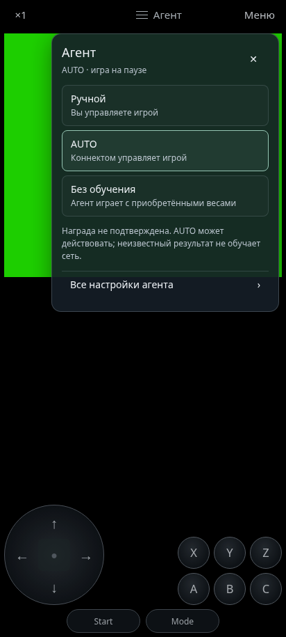
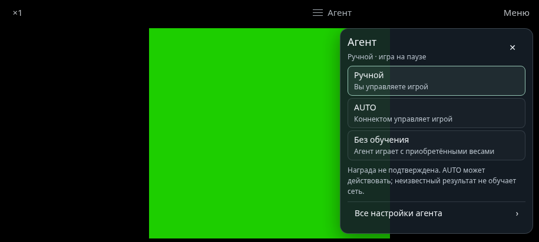

# Быстрые настройки агента · GU 2.1.3

21 октября 2026. Ветка `feature/autonomous-learning-emulator`.

В игровой строке между скоростью и «Меню» появилась кнопка **≡ Агент**.
Она открывает небольшое полупрозрачное окно справа сверху, без постоянного
HUD, лабораторных параметров или ручных наград. Во время настройки игра и
агент приостановлены, клавиатура, касания и контроллер не проходят в игру.

В окне доступны:

- **Ручной**: управление человеком, связь с агентом и обучение выключены;
  работает и без загруженного коннектома.
- **AUTO**: управление FDB-коннектомом с текущего кадра. Перед конфигурацией
  завершаются операции записи примеров и подтверждения предыдущей FDB-границы.
  Сохраняется обязательный durable Current gate перед первым inference.
- **Без обучения**: приобретённые веса используются в `eval`, обучающие
  примеры не отправляются. Это не переключатель заморозки изображения.
- **Все настройки агента**: переход к моделям, автономным отрезкам, прогрессу
  и обученной модели в полном меню.

Выбранный режим отмечен. Недоступная модель не препятствует ручной игре.
Окно сообщает об отсутствии подтверждённой награды; неизвестный результат
не превращается в нулевую или придуманную награду. RAM-профиль обозначается
как настроенный пользователем, а не универсально проверенный детектор.

Крестик, касание снаружи и Back/Escape возвращают прежнее состояние игры.
Уже приостановленная игра остаётся на паузе. Смена ROM, внешняя пауза,
уход в фон и ошибка смены режима отменяют автоматическое продолжение.
Запоздалое завершение сохранения не может открыть игру поверх другого экрана.
При выходе из двух нейронных моделей сначала требуется успешное сохранение
обеих; ошибка остаётся видимой. Выбор режима не откатывает снимок игры,
не загружает другой коннектом и не заменяет приобретённые веса старым набором.
После явного успешного повторного запуска агента закрытие окна снова
возобновляет его работу. Старая ошибка остаётся в диагностике; возобновление
проверяет текущую приостановку backend, а не наличие записи в истории.

## Проверка

Все 19 браузерных наборов прошли. Полный `tools/check.sh` и сборки
`assembleDebug lintDebug assembleRelease lintRelease` завершились с кодом 0.
Lint: 0 ошибок, 19 прежних предупреждений на вариант. Подпись debug APK и
точное совпадение 49 верхних JS/HTML/CSS-ресурсов с исходниками проверены.
Точные результаты находятся в `validation.json`, `browser-checks.json` и `.log`.
Новый `tools/agent_quick_panel_ui_check.cjs` использует настоящие ядра NES/MD и
наши тестовые ROM: проверяет геометрию в двух ориентациях, настоящие кадры,
паузу, Back, удержания, клавиатуру и запоздалый ввод контроллера, фокус, AUTO
без перезапуска, `eval` без примеров, ручной режим и отказ/запоздалый ответ
сохранения двух моделей. Ответы native FDB в этом UI-тесте — явные protocol
fixtures; тест не доказывает приобретённое поведение полного коннектома.

Скриншоты получены с нашими ROM, не с пользовательской игрой.
Все браузерные проверки подключены к Android APK workflow. Полный host-check,
Gradle debug/release и lint проверяются отдельно; итоги в `validation.json`.

## Что остаётся

Новая панель ещё требует проверки на физическом Android, включая аппаратную
кнопку «Назад», геймпад и уход в фон. Это предел доступной среды, а не
доказательство ограничения модели. Полное исходное ТЗ не объявляется закрытым.

[Разбор предоставленного журнала](device-log-review.md): все 113 событий
корректны, три lifecycle ACK успешны за 31–92 мс, но ROM в записи не загружен.
Соответствующего скриншоту таймаута и чёрного игрового экрана в архиве нет.
Причина не установлена; исправление этой ошибки не заявляется. Сырые журналы
и идентификаторы устройства в репозиторий не включены.

